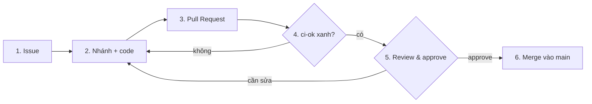

# Quy trình đóng góp

Mọi thay đổi vào `main`, kể cả tài liệu, đều đi theo một quy trình duy nhất:



| Bước | Việc phải làm | Cổng kiểm soát |
|---|---|---|
| **1. Issue** | Tạo từ mẫu `Task` / `Bug` / `Spike`. Có Acceptance Criteria kiểm chứng được, Size, Priority, Week, Phase trên Project. Việc lớn hơn `L` (> 4 ngày) phải tách. | Issue có Acceptance Criteria |
| **2. Nhánh + code** | `git switch -c <loại>/<số-issue>-<slug>` từ `main` mới nhất. Loại: `feat`, `fix`, `docs`, `chore`, `test`. Ví dụ `feat/14-section-splitter`. Logic dữ liệu: viết test trước. | `make ci` xanh cục bộ |
| **3. Pull Request** | Mở PR vào `main`, điền đủ mẫu PR, có `Closes #<số-issue>`. Một PR một Issue. Nên mở PR nháp (draft) sớm nếu việc dài. | PR liên kết đúng Issue |
| **4. CI** | GitHub Actions chạy `lint`, `test` và gộp thành `ci-ok`. Đỏ thì sửa trên cùng nhánh, không mở PR mới. | **`ci-ok` xanh (bắt buộc, Ruleset chặn merge)** |
| **5. Review & approve** | Tác giả tự review ở tab *Files changed* trước. Reviewer kiểm theo mục "Ghi chú cho reviewer", để lại góp ý, tác giả sửa và giải quyết hết hội thoại. Xem mục *Quy định review* bên dưới. | Hội thoại đã giải quyết; approve theo quy định |
| **6. Merge** | Merge bằng *Squash and merge* (một commit gọn trên `main`), xoá nhánh. Issue tự đóng nhờ `Closes #`. | Chỉ merge khi bước 4 và 5 đã đạt |

Không push thẳng lên `main`. Không dùng quyền bypass của chủ repo để bỏ qua `ci-ok`; nếu khẩn cấp, ghi lý do vào PR.

## Quy định review

- **Bắt buộc 1 approval** từ người khác (Ruleset `required_approving_review_count = 1`, từ 2026-11-08, khi Hogiaan có quyền Write). Tác giả không tự approve được PR của mình; PR của bạn do Hogiaan duyệt và ngược lại.
- Tác giả vẫn phải tự review kỹ ở tab *Files changed* và điền mục 4–5 của mẫu PR **trước** khi nhờ người kia review.
- Ruleset không đòi review của Code Owner (`require_code_owner_review = false`); `CODEOWNERS` hiện chỉ có chủ repo. Muốn ép review theo module thì thêm owner vào `CODEOWNERS` rồi bật tham số này.
- Đổi cấu hình Ruleset: sửa `.github/rulesets/main.json` trong một PR, rồi áp bằng `gh api -X PUT repos/AIVIETNAM-AIO-luciusHo/skill-radar-ai/rulesets/<ID> --input .github/rulesets/main.json` (lấy `<ID>` bằng `gh api repos/AIVIETNAM-AIO-luciusHo/skill-radar-ai/rulesets --jq '.[].id'`) và ghi quyết định vào `docs/decisions.md`.
- Review nhắm vào: đáp ứng Acceptance Criteria, đúng data contract, test có ý nghĩa (không chỉ phủ dòng), dữ liệu biên, và các nguyên tắc trong `.specify/memory/constitution.md`.

## Quy ước commit

Tiếng Anh, dạng `<loại>(<phạm vi>): <mô tả ngắn>`, ví dụ `feat(ports): add RawJD schema`. Một commit làm một việc. Không commit dữ liệu thô, khóa API, `.env`, PII hay mô hình nặng.

## Definition of Done (Issue)

Chỉ đóng Issue khi tất cả đã đạt (cũng nằm trong mẫu Issue):

- [ ] Hoàn thành toàn bộ Acceptance Criteria
- [ ] Code đáp ứng đặc tả và data contract
- [ ] Có kiểm thử phù hợp với thay đổi
- [ ] CI trên PR liên quan đã xanh (`ci-ok`)
- [ ] Đã tự review và xử lý phản hồi (có approve nếu quy định yêu cầu)
- [ ] Tài liệu cập nhật nếu cần (README, `docs/`, tick `tasks.md`, `docs/decisions.md`)
- [ ] PR đã merge vào `main`
- [ ] Không còn lỗi chặn hoặc việc tồn đọng chưa được ghi nhận (tạo Issue mới nếu có)

Đóng một giai đoạn (cổng G0–G4) thì thêm một dòng quyết định vào `docs/decisions.md`.

## Chạy kiểm tra cục bộ

```bash
make install   # uv sync --locked
make ci        # ruff check + ruff format --check + pytest, giống hệt CI
```
