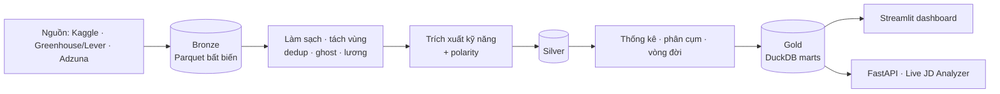

<div align="center">

# SkillRadar AI

**Radar dịch chuyển kỹ năng, mảng chuyên môn và mức lương trên thị trường lao động công nghệ.**

Đọc tin tuyển dụng thô → trích xuất kỹ năng và lương có bằng chứng → đo xu hướng theo thời gian bằng thống kê chặt chẽ.

[](https://github.com/AIVIETNAM-AIO-luciusHo/skill-radar-AI/actions/workflows/ci.yml)


[](LICENSE)

</div>

> **Trạng thái hiện tại:** giai đoạn thiết kế, khung dự án đã dựng (CI, quản trị repo, Spec Kit). **Chưa có pipeline hay kết quả thực nghiệm.** Mọi số liệu về hiệu năng trong tài liệu thiết kế là mục tiêu, không phải kết quả đo.

## Vấn đề

Đếm kỹ năng trong tin tuyển dụng nghe đơn giản nhưng dễ cho kết quả sai: một công ty đăng lặp 100 tin, tin treo hàng tháng, lương trộn giờ/tháng/năm và nhiều đồng tiền, câu phủ định kiểu *"không cần kinh nghiệm Kubernetes; đang chuyển từ PHP sang Go"*, và các tập dữ liệu có quy mô khác nhau hàng chục lần giữa các năm. SkillRadar AI xử lý các méo này một cách tường minh, rồi mới tính xu hướng.

## Hệ thống làm gì

| Năng lực | Mô tả |
|---|---|
| **Trích xuất có bằng chứng** | Kỹ năng kèm mức yêu cầu `REQUIRED / PREFERRED / NEGATED`, mỗi lần nhắc lưu `job_id` và vị trí ký tự `[char_start, char_end)` trong văn bản gốc |
| **Chống méo dữ liệu** | Khử trùng lặp MinHash LSH, lọc tin ảo > 90 ngày, loại JD rỗng, tỷ lệ chuẩn hóa thay cho số đếm, khoảng tin cậy Wilson 95% |
| **Phân tích lương** | Chuẩn hóa chu kỳ và tiền tệ, phân vị P25/P50/P75, `Disclosure Rate`, ngưỡng cỡ mẫu `N ≥ 30`; không bao giờ điền lương thiếu |
| **Phân cụm không giám sát** | Đồ thị đồng xuất hiện PPMI + Leiden và `bge-m3` + UMAP + HDBSCAN để tách các mảng chuyên môn |
| **Vòng đời kỹ năng** | Theil-Sen, Mann-Kendall (hiệu chỉnh Benjamini–Hochberg), CAGR → Emerging / Evergreen / Maturing / Declining |
| **Role drift & Bridge skills** | Đo độ trượt ngữ nghĩa của chức danh và gợi ý kỹ năng cầu nối |

## Kiến trúc



Kiến trúc Medallion (`bronze → silver → gold`) trên Parquet + DuckDB, ranh giới mô-đun theo Ports/Adapters, chạy hoàn toàn cục bộ với chi phí hạ tầng 0 VND. Kiểm tra schema bằng Pandera tại mỗi ranh giới lớp.

## Lộ trình 12 tuần

| Giai đoạn | Tuần | Mốc | Nội dung |
|---|---|---|---|
| **1 — MVP** | 1–6 | `v0.1.0` | Pipeline bronze→gold cho IT/Data&AI (Global), trích xuất bằng từ điển + luật, Mention Rate + Wilson, phân vị lương, dashboard 3 tab, gold set ≥ 100 đoạn |
| **2 — Nâng cao** | 7–10 | `v0.5.0` | NER Transformer (phải thắng baseline), entity linking `bge-m3`, phân cụm kép, vòng đời 4 góc, Salary Premium, role drift |
| **3 — Phát triển** | 11–12+ | `v1.0.0` | FastAPI + Live JD Analyzer, Docker, thị trường Việt Nam, đa ngành |

Có 5 cổng quyết định (G0–G4) và thứ tự cắt giảm khi trễ tiến độ; xem [báo cáo kỹ thuật](docs/technical-report.md) §10–11. Cổng G0 (Tuần 1) kiểm kê dữ liệu thật trước khi khóa trục thời gian.

## Bắt đầu

Yêu cầu: Linux/WSL2, [`uv`](https://docs.astral.sh/uv/), Python ≥ 3.11.

```bash
git clone https://github.com/AIVIETNAM-AIO-luciusHo/skill-radar-AI.git
cd skill-radar-AI
make install     # uv sync --locked
make ci          # ruff + pytest, đúng những gì CI chạy
```

Các lệnh `make all` (bronze → gold) và `make app` (dashboard) sẽ có khi Giai đoạn 1 hoàn thành.

## Cấu trúc thư mục

| Thư mục | Vai trò |
|---|---|
| `src/skillradar/` | Mã nguồn thư viện |
| `app/` | Dashboard Streamlit (và sau này API) |
| `configs/` | Nguồn dữ liệu, taxonomy, tỷ giá, tham số |
| `data/` | Lớp `bronze/ silver/ gold/` (không commit) và `gold_labels/` (commit) |
| `tests/` | Kiểm thử trên fixture tổng hợp, chạy < 60 giây |
| `docs/` | Báo cáo kỹ thuật, quyết định kiến trúc, hợp đồng dữ liệu, kiểm kê dữ liệu |
| `specs/` | Đặc tả theo [Spec Kit](https://github.com/github/spec-kit): `spec → plan → tasks` |
| `my-docs/` | Báo cáo kỹ thuật gốc và bài báo tham khảo |
| `notebooks/` | EDA và phân tích lỗi (không chứa logic nghiệp vụ) |
| `.github/` | CI `ci-ok`, Ruleset, mẫu Issue và PR, `CODEOWNERS` |
| `.specify/`, `.claude/` | Hiến chương dự án và kỹ năng Spec Kit cho Claude Code |

## Quy trình phát triển

1. Việc lớn đi qua Spec Kit: `/speckit-specify` → `/speckit-plan` → `/speckit-tasks` → `/speckit-implement`. Đặc tả MVP nằm ở [`specs/001-mvp-data-pipeline/`](specs/001-mvp-data-pipeline/).
2. Mỗi task là một GitHub Issue; nhánh `feat/<issue#>-<slug>`; PR ghi `Closes #n`, lệnh kiểm chứng và số liệu thật.
3. `main` được bảo vệ: chỉ merge qua PR, cần check **`ci-ok`** (`ruff check`, `ruff format --check`, `pytest`). Cấu hình Ruleset ở [`.github/rulesets/main.json`](.github/rulesets/main.json):

   ```bash
   gh api repos/AIVIETNAM-AIO-luciusHo/skill-radar-AI/rulesets --method POST --input .github/rulesets/main.json
   ```

4. Nguyên tắc bất biến của dự án: [`.specify/memory/constitution.md`](.specify/memory/constitution.md).

## Tài liệu

- [Báo cáo kỹ thuật & thiết kế hệ thống v3.0](docs/technical-report.md): bài toán, dữ liệu, kiến trúc, toán học, kế hoạch 12 tuần.
- [Sổ quyết định kiến trúc](docs/decisions.md)
- Bài báo nền: ESCO, Leiden, UMAP, DuckDB, trích xuất kỹ năng từ tin tuyển dụng (trong `my-docs/context/`).

## Đạo đức dữ liệu

Ưu tiên API và JSON công khai. Scraping chỉ sau khi đọc `robots.txt` và điều khoản từng trang, giãn cách tối thiểu 2.5 giây, không thu thập thông tin cá nhân của nhà tuyển dụng, không tái xuất bản hàng loạt nội dung có bản quyền. Dữ liệu thô không được commit.

## Giấy phép

[MIT](LICENSE) © 2026 Hồ Văn Lực
