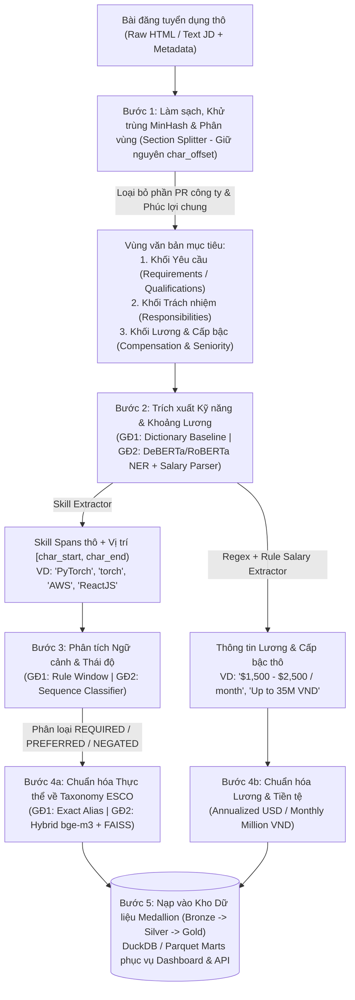
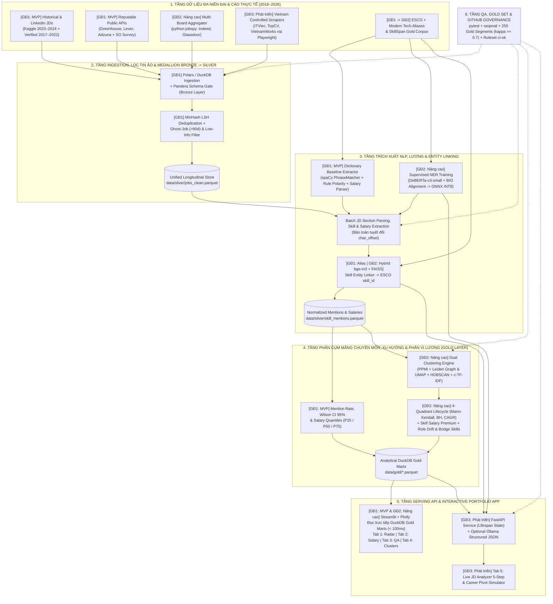
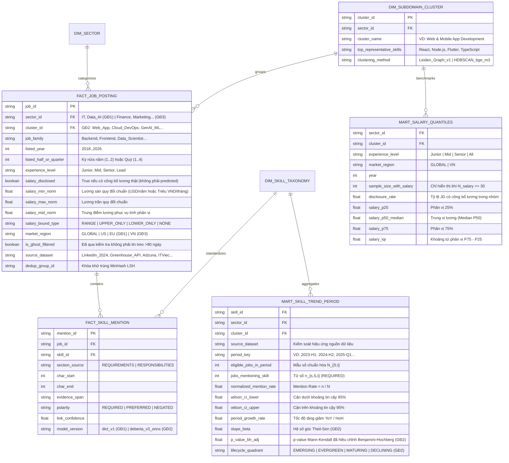

# SKILLRADAR AI 3.0 — TECHNICAL REPORT & SYSTEM DESIGN

## Hồ Sơ Thiết Kế Hệ Thống Toàn Diện — Hệ Thống NLP/LLM & Unsupervised Clustering Phân Tích Dịch Chuyển Kỹ Năng, Phân Cụm Mảng Chuyên Môn, Mức Lương & Xu Hướng Thị Trường Lao Động Đa Niên Đại (3 Giai Đoạn: MVP $\rightarrow$ Nâng Cao $\rightarrow$ Phát Triển)

> **Phiên bản:** 3.0 — 07/11/2026 (Hợp nhất toàn diện `skillradar-ai.md` v2.1 và `technical-report.md` v3.0 theo lộ trình 3 Giai đoạn: **MVP** $\rightarrow$ **Nâng cao** $\rightarrow$ **Phát triển & Mở rộng**)
>
> **Nhóm thực hiện:** 2 thành viên — **DA** (Data Analytics, Salary, Temporal Market Intelligence & Dashboard) và **ML + QA** (NLP/LLM, Unsupervised Clustering, Ingestion, Backend Serving & Kiểm thử)
>
> **Thời gian & Lộ trình:** $12\text{ tuần}$ chia làm 3 giai đoạn rõ rệt: **Giai đoạn 1 — MVP (Tuần 1–6)** $\cdot$ **Giai đoạn 2 — Nâng cao (Tuần 7–10)** $\cdot$ **Giai đoạn 3 — Phát triển & Mở rộng (Tuần 11–12+)**
>
> **Quản lý công việc:** GitHub Issues + GitHub Projects v2 + Ruleset `ci-ok` (thay thế Jira) $\cdot$ **Chi phí hạ tầng:** $0\text{ VND}$

---

## 0. Tóm Tắt Ra Quyết Định, Điểm Nâng Cấp Cốt Lõi & Cấu Trúc 3 Giai Đoạn

### 0.1 Bức tranh bài toán (Từ "Đếm Kỹ Năng Tĩnh" sang "Radar Dịch Chuyển Thị Trường & Đãi Ngộ")

Ở các hệ thống phân tích tin tuyển dụng cơ bản, việc trích xuất kỹ năng chỉ dừng lại trên một lát cắt thời gian tĩnh (snapshot $2023\text{--}2024$). Tuy nhiên, giá trị thực tiễn lớn nhất của việc phân tích thị trường lao động nằm ở **sự vận động cấu trúc theo thời gian (Non-stationarity & Structural Shift)** kết hợp với **tương quan mức đãi ngộ (Salary Premium)** và **khả năng cập nhật dữ liệu thực tế gần hiện tại**:

* **Sự dịch chuyển giữa các mảng trong cùng một ngành (Intra-Industry Shift):** Trong ngành **Công nghệ thông tin (IT)**, giai đoạn $2017\text{--}2019$ thị trường tuyển dụng ưu tiên mạnh mẽ mảng **Web/Mobile App truyền thống** (PHP, jQuery, Java Android, React/Angular đời đầu, REST CRUD). Sang giai đoạn $2020\text{--}2022$, trọng tâm dịch chuyển sang **Cloud-Native, Microservices & Data Platform** (Docker, Kubernetes, Kafka, Spark). Đến giai đoạn $2023\text{--}2026$, sự bùng nổ của Foundation Models tạo ra làn sóng **AI Engineering, RAG, VLM, MLOps & Agentic Systems**, làm thay đổi hoàn toàn yêu cầu tuyển dụng và mặt bằng lương ngay cả đối với vị trí Backend/Full-stack truyền thống.
* **Sự khác biệt tốc độ chuyển đổi giữa các ngành (Cross-Industry Evolution):** Các ngành như **Tài chính – Ngân hàng (FinTech)**, **Thương mại điện tử & Marketing**, hay **Y tế – Dược phẩm** cũng có chu kỳ đào thải và hấp thụ công nghệ rất khác nhau (ví dụ: Marketing chuyển từ SEO/Content thủ công năm $2018$ sang Growth Data Analytics năm $2021$ và AI Content/MarTech Automation năm $2025\text{--}2026$).

### 0.2 Sáu trụ cột kỹ thuật được tích hợp xuyên suốt kiến trúc SkillRadar AI 3.0

1. **Phân tích Xu hướng Đa Niên Đại & Đa Ngành (Multi-Era & Cross-Sector Longitudinal Engine):** Ghép nối dữ liệu tin tuyển dụng qua nhiều giai đoạn theo từng ngành (`IT & Software`, `Data & AI`, và mở rộng sang `Finance & FinTech`, `Business & Marketing`, `Engineering & Manufacturing`), đi kèm thuật toán **chuẩn hóa mẫu số (`Mention Rate`)** để so sánh sòng phẳng giữa dữ liệu lịch sử và dữ liệu mới thu thập.
2. **Thu thập Dữ liệu Gần Hiện Tại Hợp Quy & Lọc Tin Ảo (Compliant Live Ingestion & Ghost-Job Filtering):** Kết hợp các cổng API tuyển dụng uy tín (`Greenhouse/Lever Public Boards`, `Adzuna`, `Jooble`) với thư viện `JobSpy` và trình thu thập có kiểm soát cho thị trường Việt Nam (`ITViec`, `TopCV`, `VietnamWorks`), đi kèm bộ lọc loại bỏ tin đăng lặp (`MinHash LSH`) và tin tuyển dụng ảo (`Ghost Jobs` mở quá $90\text{ ngày}$).
3. **Quy trình 5 Bước Biến Bài Đăng Tuyển Dụng Thô (Raw JD) Thành Dữ Liệu Phân Tích Chuẩn Mực:** Tách vùng văn bản (`Section Splitter` giữ nguyên `char_offset`) $\rightarrow$ Nhận diện thực thể kỹ năng & khoảng lương (`Dictionary / NER + Salary Parser`) $\rightarrow$ Phân loại thái độ ngữ cảnh (`REQUIRED` / `PREFERRED` / `NEGATED`) $\rightarrow$ Chuẩn hóa về từ điển `ESCO` & quy đổi tiền tệ $\rightarrow$ Nạp vào kho phân tích `DuckDB`/`Parquet` theo kiến trúc Medallion (`Bronze` $\rightarrow$ `Silver` $\rightarrow$ `Gold`).
4. **Phân cụm Không giám sát các Mảng chuyên môn trong Ngành (Unsupervised Sub-Domain Clustering):** Dùng biểu diễn vector ngữ nghĩa (`BAAI/bge-m3`) kết hợp giảm chiều `UMAP` + phân cụm mật độ `HDBSCAN` và **Phát hiện cộng đồng trên Đồ thị Đồng xuất hiện Kỹ năng (`Leiden Community Detection`)** để tự động gom các kỹ năng và JD thành từng "Mảng con" (*Web/App Frontend*, *Cloud/DevOps*, *Data Engineering*, *GenAI/LLM Systems*).
5. **Phân loại Động thái Tăng/Giảm 4 Góc phần tư & So sánh Phân vị Lương (4-Quadrant Lifecycle & Salary Quantiles):** Định lượng tốc độ tăng trưởng kép ($\text{CAGR}$), độ dốc xu hướng ($\beta$), kiểm định **Mann-Kendall** trên các kỳ nửa năm/quý (kèm hiệu chỉnh đa kiểm định Benjamini–Hochberg), đồng thời vẽ biểu đồ phân vị lương ($P_{25}, P_{50}, P_{75}$ bằng Boxplot/Violin Plot) theo cấp bậc (`Seniority`) và cụm kỹ năng.
6. **Đo lường Độ trượt Ngữ nghĩa Chức danh & Mô phỏng Chuyển dịch Sự nghiệp (Role Drift & Bridge-Skill Simulator):** Tính khoảng cách dịch chuyển tâm cụm $\Delta_{\text{cosine}}(C_{t_1}, C_{t_2})$ của cùng một chức danh giữa các giai đoạn và gợi ý các **Bridge Skills (Kỹ năng cầu nối)** giúp người học chuyển dịch từ mảng đang bão hòa sang mảng đang tăng trưởng.

### 0.3 Bảng điều chỉnh chiến lược sang mô hình 3 Giai đoạn (MVP $\rightarrow$ Nâng cao $\rightarrow$ Phát triển)

Để đảm bảo nhóm 2 người chắc chắn có sản phẩm chạy hoàn chỉnh từ sớm nhưng không đánh mất bất kỳ ý tưởng nâng cao nào, dự án được chuẩn hóa theo các điều chỉnh sau:

| # | Thiết kế cũ (1 pha 8 tuần) | Thiết kế 3.0 (3 Giai đoạn — 12 tuần) | Lý do kỹ thuật & Quản trị rủi ro |
| :--- | :--- | :--- | :--- |
| **1** | 8 tuần dàn trải, làm tất cả cùng lúc | **Chia 3 giai đoạn:** **GĐ1 MVP (Tuần 1–6)** $\rightarrow$ **GĐ2 Nâng cao (Tuần 7–10)** $\rightarrow$ **GĐ3 Phát triển & Mở rộng (Tuần 11–12+)** | Có sản phẩm chạy end-to-end ở cuối Tuần 6 (`v0.1.0`); nếu trễ tiến độ chỉ co gọn GĐ3 mà không bao giờ hỏng MVP |
| **2** | Quản lý bằng Jira (`KAN-xx`) rời rạc | **GitHub Issues + GitHub Projects v2**, liên kết PR bằng `Closes #n` + Ruleset `ci-ok` | Tập trung code, review chéo, dữ liệu kiểm thử và tiến độ tại 1 nơi duy nhất |
| **3** | Ôm 5 ngành, VN + Global ngay từ tuần đầu | **GĐ1 (MVP):** Ngành IT/Data&AI, thị trường Global.<br>**GĐ2 (Nâng cao):** Mở rộng nguồn `JobSpy` + phân cụm.<br>**GĐ3 (Phát triển):** Scraping thị trường VN + đa ngành ngoài IT | Hai người cần ưu tiên chiều sâu và độ chặt chẽ thống kê của ngành IT/Data trước khi nhân rộng pipeline sang ngành khác |
| **4** | Giả định sẵn có dữ liệu JD 2017–2022 | **Tuần 1 bắt buộc Kiểm kê dữ liệu (`G0` — `docs/data_inventory.md`)** trước khi khóa trục thời gian | Xác minh thực tế kích thước, tỷ lệ có lương và giấy phép của các bộ dữ liệu lịch sử trước khi viết code ETL |
| **5** | Đặt nặng huấn luyện Transformer NER ngay từ đầu | **GĐ1 (MVP):** Dùng `Dictionary Baseline` (`ESCO` + alias) làm lõi chạy toàn pipeline.<br>**GĐ2 (Nâng cao):** Fine-tune `DeBERTa-v3-small` NER để chứng minh độ vượt trội so với Baseline | Giúp pipeline dữ liệu và Dashboard chạy được ngay ở GĐ1 mà không bị chặn bởi thời gian huấn luyện GPU |
| **6** | Mann-Kendall tính trên chuỗi năm (4–8 điểm) | Chuyển sang tính trên **bucket nửa năm (Half-year) hoặc Quý (Quarter)** ($\ge 6\text{--}12$ điểm) + hiệu chỉnh **Benjamini–Hochberg** | Chuỗi thời gian quá ngắn theo năm có công suất kiểm định (statistical power) thấp; chia theo quý/nửa năm giúp kiểm định $p\text{-value}$ tin cậy hơn |
| **7** | Trùng lặp công cụ (FAISS + ChromaDB, BERTopic, Instructor...) | Tinh gọn ở GĐ1–GĐ2 (`DuckDB`, `Polars`, `FAISS/NumPy`, `c-TF-IDF` tự cài), đưa `FastAPI`, `Ollama` và `Playwright VN` sang GĐ2–GĐ3 | Giảm bề mặt bảo trì (maintenance surface), giữ môi trường `uv.lock` gọn nhẹ và ổn định |

### 0.4 Ma trận Phân bổ Tính năng theo 3 Giai đoạn

| Thành phần hệ thống | Giai đoạn 1: MVP (Tuần 1 – 6)<br>*(Nền tảng Dữ liệu & Thống kê Lõi)* | Giai đoạn 2: Nâng cao (Tuần 7 – 10)<br>*(Deep NLP, Phân cụm & Vòng đời)* | Giai đoạn 3: Phát triển & Mở rộng (Tuần 11 – 12+)<br>*(Production API, Thị trường VN & Đa ngành)* |
| :--- | :--- | :--- | :--- |
| **Phạm vi Ngành & Thị trường** | Ngành `IT & Software`, `Data & AI` (Thị trường Global) | Mở rộng độ phủ JD `2025–2026` qua `JobSpy` (Indeed, Glassdoor, LinkedIn) | Mở rộng thị trường **Việt Nam** (`ITViec`, `TopCV`, `VietnamWorks`) & **Đa ngành** (`Finance`, `Marketing`, `Healthcare`) |
| **Tầng Dữ liệu & Chống méo** | Kiến trúc `Bronze -> Silver -> Gold` (`DuckDB` + `Polars`); lọc trùng `MinHash LSH`, lọc `Ghost Jobs`, chuẩn hóa `Mention Rate` + `Wilson CI` | Chạy lại toàn bộ kho `Silver/Gold v2` bằng mô hình NLP tốt nhất; kiểm định chéo Spearman với `Stack Overflow Survey` | Tự động hóa lập lịch thu thập định kỳ (Incremental Ingestion) & chuẩn hóa đa tiền tệ (`USD` $\leftrightarrow$ `VND`) |
| **Tầng NLP & Trích xuất** | `section_splitter` (giữ `char_offset`), `Dictionary Baseline` (`ESCO` + alias), luật `Polarity` (`REQUIRED/PREFERRED/NEGATED`), `Salary Parser` | Fine-tune **Transformer NER (`DeBERTa-v3-small`)** trên `SkillSpan` + xuất `ONNX INT8`; **Hybrid Entity Linker (`BAAI/bge-m3` + `FAISS`)** | Tích hợp **LLM có cấu trúc (`Ollama` + `Pydantic v2`)** để đối sánh RQ5 và sinh báo cáo giải thích xu hướng có dẫn nguồn |
| **Tầng Phân cụm & Xu hướng** | Thống kê theo nhóm nghề (`job_family`), phân vị lương $P_{25}/P_{50}/P_{75}$ & `Disclosure Rate` | **Dual Clustering (`PPMI + Leiden` & `UMAP + HDBSCAN + c-TF-IDF`)**, **4-Quadrant Lifecycle** (`Theil-Sen`, `Mann-Kendall`, `CAGR`), **Salary Premium ($\Delta W_s$)**, **Role Drift & Bridge Skills** | Phân tích **Quy luật thay thế kỹ năng (`Skill Cannibalization` — RQ10)** & dự báo dịch chuyển liên ngành |
| **Tầng Serving & Giao diện** | `Streamlit` đọc trực tiếp `DuckDB`: **Tab 1 (Market Radar)**, **Tab 2 (Salary Quantiles)**, **Tab 3 (Hygiene & Baseline QA)** | Bổ sung **Tab 4 (Sub-Domain Clusters, 4-Quadrant Matrix & Skill Salary Premium)** | Dựng **`FastAPI` (`lifespan`)**, mở **Tab 5 (Live JD Analyzer 5-Step & Career Pivot Simulator)**, đóng gói `Docker` |
| **Kiểm thử & Đánh giá** | $\ge 100$ đoạn Gold Set ($\kappa \ge 0.7$), unit tests `QA-TIME`, `QA-INGEST`, `QA-SAL`, `QA-NLP`, CI `ci-ok` xanh | Hoàn tất **250 đoạn Gold Set** (150 dev / 100 held-out), báo cáo benchmark `Baseline` vs `Transformer NER` | Kiểm thử tải `FastAPI`, benchmark độ trễ $p95 < 200\text{ ms}$ và kiểm toán bảo mật/PII trước khi phát hành `v1.0.0` |

---

## 1. Định Hình Bài Toán, Chân Dung Người Dùng & Câu Hỏi Nghiên Cứu (Gắn Theo 3 Giai Đoạn)

### 1.1 Chân dung người dùng (Personas)

* **Ứng viên / Kỹ sư định hướng nghề nghiệp:** Muốn nhìn thấy bức tranh tiến hóa thực sự của ngành (từ Web/App sang AI-Integrated Engineering), đối chiếu mức lương phân vị ($P_{25}\text{--}P_{75}$) của từng mảng và biết cần học thêm "kỹ năng cầu nối" (`Bridge Skills`) nào để nâng cấp thu nhập.
* **Chuyên viên phân tích thị trường lao động (Labor-Market & Sector Analyst):** Cần theo dõi sự dịch chuyển cơ cấu bên trong từng ngành qua các năm, kết hợp cả dữ liệu lịch sử lẫn dữ liệu tuyển dụng mới thu thập từ các nguồn uy tín, kèm điều kiện minh bạch về độ bao phủ mẫu.
* **Kỹ sư NLP / AI Systems:** Đánh giá khả năng bóc tách thông tin có cấu trúc (Structured Information Extraction) từ bài đăng tuyển dụng thô nhiều nhiễu và khả năng gom cụm không giám sát khi xuất hiện thuật ngữ công nghệ mới.

### 1.2 Mười một câu hỏi sản phẩm & nghiên cứu (Research Questions — RQ) phân theo 3 Giai đoạn

| Mã RQ | Câu hỏi sản phẩm & Khoa học dữ liệu | Giai đoạn giải quyết |
| :--- | :--- | :--- |
| **RQ1 (Intra-Industry Shift)** | Trong ngành IT, tỷ trọng nhu cầu giữa mảng *Web/Mobile App*, *Data/Cloud* và *AI/ML* đã thay đổi như thế nào qua các giai đoạn? | **GĐ1: MVP** (theo nhóm chức danh) $\rightarrow$ **GĐ2: Nâng cao** (theo cụm tự động) |
| **RQ2 (Salary Quantiles)** | Phân phối mức lương ($P_{25}, P_{50}\text{ - Median}, P_{75}$) giữa các mảng chuyên môn và giữa các cấp bậc (*Junior, Mid, Senior*) chênh lệch nhau ra sao trên tập tin tuyển dụng có công bố lương? | **GĐ1: MVP** (theo cấp bậc/nhóm nghề) $\rightarrow$ **GĐ2: Nâng cao** (kèm Skill Salary Premium $\Delta W_s$) |
| **RQ3 (Skill Lifecycle)** | Kỹ năng nào đang ở pha **Tăng trưởng nóng (Emerging)**, **Trụ cột bất biến (Evergreen Core)**, **Bão hòa (Maturing)**, và **Suy giảm (Declining)**? | **GĐ2: Nâng cao** |
| **RQ4 (Unsupervised Clustering)** | Không cần định nghĩa luật thủ công, thuật toán phân cụm trên đồ thị kỹ năng (`PPMI + Leiden`) và văn bản (`UMAP + HDBSCAN`) có tự động tách được các mảng chuyên môn mới (như *LLM/RAG Engineering* tách khỏi *Classical Data Science*) không? | **GĐ2: Nâng cao** |
| **RQ5 (Extraction Benchmark)** | Độ chính xác của `Rule/Dictionary Baseline`, `Fine-tuned Transformer NER` (`DeBERTa`/`RoBERTa`) và `Constrained LLM` khác nhau bao nhiêu trên tập JD thực tế $2025\text{--}2026$? | **GĐ1: MVP** (Baseline) $\rightarrow$ **GĐ2: Nâng cao** (NER) $\rightarrow$ **GĐ3: Phát triển** (LLM) |
| **RQ6 (Negation & Stance)** | Khi JD viết *"No experience with Kubernetes required; we are migrating from PHP to Go"*, hệ thống có phân biệt được kỹ năng đang tuyển (`Go = REQUIRED`) và kỹ năng không yêu cầu/đang bỏ (`Kubernetes, PHP = NEGATED`) không? | **GĐ1: MVP** (Luật ngữ cảnh) $\rightarrow$ **GĐ2: Nâng cao** (Sequence Classifier nếu cần) |
| **RQ7 (Evidence Traceability)** | Mọi con số thống kê xu hướng, mức lương và kỹ năng trích xuất có dẫn chiếu ngược về đúng đoạn văn bản gốc (`job_id`, `char_start`, `char_end`, `year`) không? | **GĐ1: MVP** (Bắt buộc xuyên suốt cả 3 giai đoạn) |
| **RQ8 (Anti-Distortion Impact)** | Việc loại bỏ tin đăng lặp (`MinHash LSH`) và tin tuyển dụng ảo (`Ghost Jobs`) làm thay đổi bảng xếp hạng kỹ năng và mức lương bao nhiêu phần trăm so với đếm thô? | **GĐ1: MVP** |
| **RQ9 (Role Drift & Bridge Skills)** | Cùng chức danh `"Backend Engineer"` hoặc `"Data Scientist"`, bộ kỹ năng yêu cầu hiện tại đã dịch chuyển bao nhiêu phần trăm ($\Delta_{\text{cosine}}$) so với trước đây, và kỹ năng cầu nối nào giúp chuyển mảng ngắn nhất? | **GĐ2: Nâng cao** |
| **RQ10 (Skill Cannibalization)** | Khi một công nghệ cũ giảm xuống (ví dụ: `jQuery`, `SOAP`, `Hadoop MapReduce`), công nghệ nào trong cùng phân khúc đang tăng lên để thế chỗ? | **GĐ3: Phát triển & Mở rộng** |
| **RQ11 (Cross-Sector & Vietnam Market)** | Các ngành ngoài IT (Tài chính, Marketing, Bán lẻ) hấp thụ kỹ năng số/AI chậm hơn bao nhiêu so với ngành IT, và mặt bằng kỹ năng/lương tại **Việt Nam** khác biệt ra sao so với Global? | **GĐ3: Phát triển & Mở rộng** |

> **Ngoài phạm vi (Out of Scope chủ ý):** Dự đoán lương cá nhân hóa cho từng ứng viên, tự động chấm điểm/loại hồ sơ tuyển dụng, huấn luyện LLM hàng tỷ tham số từ đầu, hạ tầng Cloud trả phí, hoặc lưu trữ thông tin cá nhân (PII) của nhà tuyển dụng.

---

## 2. Chiến Lược Dữ Liệu Đa Niên Đại, Kiểm Kê Cổng G0, Cách Cào Dữ Liệu Gần Hiện Tại & Quy Trình 5 Bước

### 2.1 Hệ sinh thái dữ liệu phân theo 3 Giai đoạn: Lịch sử ($2017\text{--}2024$) + Cào mới gần hiện tại ($2025\text{--}2026$)

| Nhóm dữ liệu | Nguồn cụ thể | Khung thời gian | Giai đoạn triển khai | Vai trò & Lưu ý kiểm định |
| :--- | :--- | :--- | :--- | :--- |
| **Kho Lịch sử Chính thống** | LinkedIn Job Postings ($\sim 124\text{K}$ & $1.3\text{M}$ Kaggle Snapshots) | $2023\text{--}2024$ | **GĐ1: MVP** | Lõi lịch sử cho kỷ nguyên **Modern Data Stack, Cloud-Native & Early GenAI** |
| **Kho Lịch sử Mở rộng** | Kaggle Historical Tech & Multi-Industry Jobs (Reed, Monster, Dice, DataJob) | $2017\text{--}2022$ | **GĐ1: MVP** *(Nếu đạt cổng kiểm kê `G0` Tuần 1)* | Đại diện kỷ nguyên **Pre-GenAI (Web/Mobile App, Monolith $\rightarrow$ Early Cloud)**; bắt buộc tách theo `source_dataset` |
| **Kho Đối chiếu Độc lập** | Stack Overflow Annual Developer Survey & JetBrains/GitHub Octoverse CSV | $2018\text{--}2025$ | **GĐ1: MVP** *(EDA)* & **GĐ2** *(Kiểm định Spearman)* | Chuỗi thời gian chuẩn mực để **kiểm chứng chéo (Cross-validation)** xu hướng công nghệ và mức lương theo năm |
| **Dữ liệu Mới Qua API Hợp quy (Quốc tế)** | **Greenhouse / Lever Public JSON Boards**, **Adzuna REST API**, **Jooble API** | $2025\text{--}2026$ | **GĐ1: MVP** | Dữ liệu thực tế sạch, hợp pháp $100\%$ từ trang tuyển dụng chính thức của các tập đoàn công nghệ |
| **Dữ liệu Mới Đa nền tảng** | Thư viện **`python-jobspy`** (Indeed, LinkedIn Public, Glassdoor, ZipRecruiter) | $2025\text{--}2026$ | **GĐ2: Nâng cao** | Mở rộng độ phủ mẫu cho năm $2025\text{--}2026$ để tăng độ chính xác khi phân cụm và đo lương |
| **Dữ liệu Cào Thị trường Việt Nam** | **ITViec**, **TopCV**, **VietnamWorks**, **CareerViet**, **Glints VN** (`Playwright` + `selectolax`) | $2025\text{--}2026$ | **GĐ3: Phát triển** | Phản ánh sát thực tế nhu cầu kỹ năng và mặt bằng lương (Triệu VND/tháng) tại Việt Nam sau khi kiểm tra `robots.txt` |
| **Tập Nhãn & Từ điển Chuẩn** | **ESCO Taxonomy** + **Modern Tech Aliases** (GĐ1) + **SkillSpan Corpus** (GĐ2) | Chuẩn học thuật | **GĐ1** (Từ điển) $\rightarrow$ **GĐ2** (Huấn luyện NER) | Chuẩn hóa thực thể kỹ năng đa phiên bản và huấn luyện/đánh giá độc lập mô hình Token Classification |

### 2.2 Cổng Kiểm kê Dữ liệu bắt buộc ở Tuần 1 (Data Inventory Gate — `G0`)

Trước khi khóa cứng trục thời gian, trong **Tuần 1**, nhóm bắt buộc kiểm kê mọi tập dữ liệu ứng viên vào file `docs/data_inventory.md` (ghi rõ: nguồn, giấy phép, số bản ghi hợp lệ theo năm, tỷ lệ có lương công bố, tỷ lệ có mô tả $\ge 100$ ký tự, ngôn ngữ):

* **Quy tắc khóa trục thời gian:** Cần tối thiểu **3 giai đoạn thời gian (hoặc $\ge 6$ kỳ nửa năm/quý)**, mỗi giai đoạn có $\ge 2.000$ JD hợp lệ để kết luận về xu hướng thống kê.
* **Phương án dự phòng trung thực khoa học:** Nếu một bộ dữ liệu lịch sử giai đoạn $2017\text{--}2020$ không đạt kiểm kê hoặc khác biệt quá lớn về phân phối địa lý (ví dụ: chỉ gồm tin tuyển dụng tại Anh trên Reed UK), hệ thống **không gộp chung một cách cơ học** với LinkedIn Global mà tách riêng theo khóa `(source_dataset, market_region)`, đồng thời dùng chuỗi khảo sát `Stack Overflow Developer Survey (2018–2025)` làm chuỗi tham chiếu dài hạn (ghi chú rõ trên giao diện là dữ liệu khảo sát lập trình viên, không trộn lẫn với mẫu số JD).

### 2.3 Cách cào dữ liệu gần hiện tại từ các trang uy tín (Web Scraping & APIs hợp quy theo từng Giai đoạn)

Để đưa dữ liệu sát với thời điểm hiện tại ($2025\text{--}2026$) vào hệ thống mà **không vi phạm pháp lý, không bị khóa IP và đảm bảo độ tin cậy cao nhất**, hệ thống thiết kế tầng thu thập đa luồng theo 3 nhóm nguồn tương ứng với 3 giai đoạn:

1. **Nhóm 1 (Triển khai ngay ở Giai đoạn 1 — MVP) — Cổng API Tuyển dụng Chính thống & ATS Công khai:**
   * **Greenhouse & Lever Public Job Board APIs:** Hàng nghìn công ty công nghệ uy tín (như Stripe, Airbnb, Cloudflare, Databricks, Grab, GitLab...) công khai toàn bộ tin tuyển dụng đang mở qua endpoint JSON chuẩn (`https://boards-api.greenhouse.io/v1/boards/{company}/jobs?content=true`) mà không cần xác thực phức tạp hay lo ngại tin rác.
   * **Adzuna API & Jooble REST API:** Cung cấp gói miễn phí cho nhà phát triển, trả về JSON chuẩn hóa gồm `title`, `description`, `company`, `location`, `created_at`, và trường `salary_min`, `salary_max`. *(Lưu ý kiểm định: với Adzuna, bắt buộc kiểm tra cờ `salary_is_predicted`; nếu là lương do nền tảng tự dự đoán thì gán `salary_disclosed = False`, tuyệt đối không đưa vào tính phân vị lương thật).*

2. **Nhóm 2 (Triển khai ở Giai đoạn 2 — Nâng cao) — Thư viện Mã nguồn mở Chuyên dụng Đa nền tảng (`JobSpy`):**
   * Tích hợp thư viện Python **`python-jobspy`** để thu thập có kiểm soát các bài đăng mới nhất từ **Indeed**, **LinkedIn (Public Jobs)**, **Glassdoor**, và **ZipRecruiter**.
   * **Cơ chế an toàn:** Tự động xoay vòng `User-Agent`, giới hạn số trang truy vấn mỗi phiên (`results_wanted <= 100` mỗi batch), hỗ trợ truyền cấu hình nghỉ (`sleep_interval`) để không gây quá tải máy chủ đích.

3. **Nhóm 3 (Triển khai ở Giai đoạn 3 — Phát triển & Mở rộng) — Thu thập có kiểm soát tại các trang tuyển dụng uy tín ở Việt Nam (`ITViec`, `TopCV`, `VietnamWorks`, `CareerViet`):**
   * Sử dụng **`Playwright` (chế độ Headless Async)** kết hợp trình phân tích HTML tốc độ cao **`selectolax` / `BeautifulSoup4`**.
   * **Quy tắc đạo đức & kỹ thuật bắt buộc (Ethical Scraping Policy):**
     * Kiểm tra và tuân thủ tệp `robots.txt` cùng điều khoản sử dụng (ToS) của từng tên miền trước khi khởi chạy.
     * Áp dụng bộ điều tiết tốc độ thích ứng (**Token-Bucket Rate Limiter**): thời gian nghỉ giữa hai request liên tiếp tối thiểu $\Delta t \ge 2.5\text{ giây}$ cộng thêm nhiễu ngẫu nhiên $\text{Uniform}(0.5, 1.5)\text{ s}$ (jitter).
     * Chỉ thu thập các trường thông tin nghiệp vụ công khai (`job_title`, `industry`, `job_description`, `requirements`, `published_salary`, `posted_date`, `location_city`). **Tuyệt đối không thu thập** tên cá nhân, số điện thoại hay email của nhân sự tuyển dụng (PII Removal).
     * Lưu trữ dưới dạng đặc trưng đã trích xuất (extracted features) và mã băm (`description_hash`), không tái xuất bản (republish) nguyên văn hàng loạt bài đăng có bản quyền.

### 2.4 Quy trình đánh giá và kiểm định để số liệu không bị bóp méo (3 Màng lọc Anti-Distortion — Bắt buộc từ GĐ1 MVP)

Dữ liệu cào trực tiếp từ thực tế luôn chứa nhiều nhiễu hệ thống. Trước khi đưa vào phân tích xu hướng hay vẽ biểu đồ lương, dữ liệu bắt buộc phải đi qua **3 màng lọc chống bóp méo**:

1. **Khử trùng lặp đa nền tảng bắt buộc (Cross-Site Near-Deduplication):**
   * *Vấn đề:* Một công ty thường đăng lặp lại cùng 1 vị trí tuyển dụng qua nhiều tuần để đẩy tin lên đầu trang, hoặc đăng chéo cùng lúc lên 3 nền tảng (ví dụ: vừa đăng trên ITViec, vừa đăng trên TopCV và LinkedIn).
   * *Giải pháp:* Chuẩn hóa văn bản $\rightarrow$ băm thành tập $k\text{-shingles}$ ($k=5$) $\rightarrow$ chạy thuật toán **`MinHash LSH`** ($128$ hàm băm, ngưỡng tương đồng Jaccard $\ge 0.85$) kết hợp khóa ghép `(normalized_company, normalized_title, quarter)` để gán chung một mã `dedup_group_id`. Khi thống kê nhu cầu kỹ năng, mỗi `dedup_group_id` trong một quý chỉ được tính đúng **$1\text{ lần}$ duy nhất**.

2. **Đo lường bằng Tỷ lệ hiện diện chuẩn hóa (`Mention Rate`), tuyệt đối không đếm số lượng tuyệt đối:**
   * Vì quy mô dữ liệu mỗi năm/kỳ và mỗi nguồn cào khác nhau, mọi phép so sánh xu hướng tăng/giảm đều phải tính qua tỷ lệ hiện diện chuẩn hóa của kỹ năng $s$ trong ngành $C$ tại kỳ $t$ (chỉ tính `polarity == REQUIRED` vào tử số chính; `PREFERRED` thống kê riêng; `NEGATED` loại khỏi tử số):

   $$
   \text{Mention Rate}(s, C, t) = \frac{\text{Số JD hợp lệ (đã khử trùng) trong ngành } C \text{ kỳ } t \text{ có yêu cầu kỹ năng } s}{\text{Tổng số JD hợp lệ của ngành } C \text{ kỳ } t}
   $$

   * *Ý nghĩa thực tiễn:* Công thức này giúp dữ liệu mới cào năm $2025\text{--}2026$ (ví dụ thu thập được $2.000$ tin chất lượng cao) so sánh sòng phẳng, khách quan với dữ liệu lịch sử (gồm $50.000\text{--}120.000$ tin) mà không bị lệch do quy mô mẫu thu thập. Đi kèm mỗi tỷ lệ là **khoảng tin cậy Wilson $95\%$**:

   $$
   \text{CI}_{\text{Wilson}} = \frac{\hat{p} + \frac{z^2}{2n} \pm z \sqrt{\frac{\hat{p}(1-\hat{p})}{n} + \frac{z^2}{4n^2}}}{1 + \frac{z^2}{n}} \quad (z = 1.96)
   $$

3. **Lọc bỏ tin tuyển dụng ảo và tin rác môi giới (`Ghost Jobs` & Low-Information Filtering):**
   * **Quy tắc lọc Ghost Jobs (áp dụng cho nguồn có `first_seen` / `last_seen`):** Loại bỏ hoặc gắn cờ riêng (`is_ghost_job = True`) đối với các bài đăng mở liên tục trên **$90\text{ ngày}$** mà nội dung không hề thay đổi, hoặc cùng một công ty đăng lại cùng một vị trí quá $4\text{ lần}$ liên tiếp trong 6 tháng mà không tuyển dụng thực tế. *(Với tập Kaggle tĩnh không có `first_seen/last_seen`, áp dụng lọc trùng `MinHash` và lọc JD rỗng, ghi rõ trong `docs/data_contract.md`).*
   * **Quy tắc lọc JD rỗng (Low-Information JDs):** Loại bỏ các tin tuyển dụng chỉ chứa khẩu hiệu chung chung, không tách được phần *Yêu cầu công việc* hoặc tổng số ký tự mô tả chuyên môn $< 100\text{ ký tự}$.

### 2.5 Quy trình 5 Bước biến Bài đăng tuyển dụng thô (Raw JD) thành Data đánh giá việc làm & Mức lương

Hệ thống chuyển hóa một bài đăng tuyển dụng bất kỳ (từ file CSV lịch sử, từ API hoặc vừa cào về) thành bản ghi dữ liệu phân tích chuẩn hóa thông qua đường ống **5 bước Information Extraction** (nâng cấp dần độ tinh vi từ GĐ1 sang GĐ2):



#### Chi tiết kỹ thuật của 5 bước chuyển đổi và Quy tắc Lương nghiêm ngặt:

1. **Bước 1 — Làm sạch HTML, Khử trùng lặp & Phân vùng bố cục (`Section Splitter`):**
   * Chuyển đổi HTML/Markdown về văn bản thuần nhưng **bảo toàn tuyệt đối chỉ số vị trí ký tự (`char_offset`) trên chuỗi gốc**.
   * Dùng bộ nhận diện tiêu đề mục (Heading Regex + Layout Heuristics) để tách riêng 3 khối: *About Company* (bỏ qua khi đếm skill của vị trí để tránh nhiễu), *Responsibilities & Requirements* (nguồn chính để trích xuất kỹ năng), và *Benefits / Salary* (nguồn trích xuất đãi ngộ).

2. **Bước 2 — Trích xuất thực thể kỹ năng (`Baseline` $\rightarrow$ `NER`) và Bóc tách mức lương (`Salary Parser`):**
   * **Trích xuất kỹ năng:**
     * *Ở Giai đoạn 1 (MVP):* Dùng `spaCy PhraseMatcher` kết hợp từ điển `ESCO` + bảng alias công nghệ, tôn trọng ranh giới từ đặc biệt (`C++`, `C#`, `.NET Core`, `Node.js`, `CI/CD`).
     * *Ở Giai đoạn 2 (Nâng cao):* Mô hình Transformer (`DeBERTa-v3-small` / `RoBERTa` huấn luyện trên `SkillSpan`) quét qua văn bản để bóc các span `SKILL` và `KNOWLEDGE` kèm tọa độ `[char_start, char_end)`.
   * **Trích xuất mức lương:** Kết hợp trường lương công bố từ API với bộ phân tích biểu thức chính quy đa mẫu (`Salary Regex Parser`) ngay trong nội dung JD:
     * Khoảng lương đầy đủ: `"15 - 25 triệu"`, `"$1,500 - $2,500"`, `"$120k - $160k/yr"` $\rightarrow$ `salary_bound_type = "RANGE"`.
     * Lương một phía (trần / sàn): `"Up to $3,000"`, `"Từ 20 triệu"` $\rightarrow$ lưu `salary_bound_type = "UPPER_ONLY"` hoặc `"LOWER_ONLY"`.
     * Không công bố: `"Thỏa thuận"`, `"Negotiable"`, `"Competitive"` $\rightarrow$ gắn nhãn `salary_disclosed = False`.

3. **Bước 3 — Phân tích ngữ cảnh phủ định & Mức độ yêu cầu (`Stance & Negation Detection`):**
   * Phân biệt rõ giữa kỹ năng **Bắt buộc (`REQUIRED`)**, **Điểm cộng (`PREFERRED` / `NICE_TO_HAVE`)** và **Phủ định / Công nghệ cũ đang bỏ (`NEGATED`)**.
   * Ví dụ: Câu *"No prior experience with Kubernetes is required; migrating from PHP to Go; nice to have Docker"* sẽ gán `Go -> REQUIRED`, `Docker -> PREFERRED`, còn `Kubernetes` và `PHP` mang nhãn `NEGATED` (tuyệt đối không đưa vào tử số nhu cầu tuyển dụng).

4. **Bước 4 — Chuẩn hóa từ đồng nghĩa (`Entity Linking`) & Quy tắc chuẩn hóa mức lương (`Salary Normalization`):**
   * **Chuẩn hóa kỹ năng:** Ở GĐ1 dùng từ điển alias chính xác; sang GĐ2 kết hợp thêm khoảng cách cosine của vector nhúng **`BAAI/bge-m3`** + `FAISS/NumPy` để gom các biến thể mới về cùng một mã `skill_id` chuẩn trong **ESCO + Modern Tech Taxonomy**.
   * **Quy tắc chuẩn hóa mức lương minh bạch (Không suy diễn tùy tiện):**
     * Quy đổi mọi chu kỳ trả lương (`hourly`, `daily`, `monthly`, `yearly`) về chuẩn thống nhất: **`Annualized USD`** (cho tập dữ liệu quốc tế) và **`Monthly Million VND`** (cho tập dữ liệu Việt Nam ở GĐ3), áp dụng bảng tỷ giá tham chiếu theo năm đăng tuyển lưu trong `configs/taxonomy.yaml`.
     * Với các tin chỉ ghi `"Up to X"` (`UPPER_ONLY`), hệ thống **tách riêng và không gộp trực tiếp vào phân vị chính** để tránh làm lệch trung vị (chỉ dùng hệ số ước lượng $\text{Midpoint} \approx 0.8 \times X$ trong bảng phân tích độ nhạy phụ nếu cần đối chiếu).
     * Loại bỏ các giá trị ngoại lai vô lý ($< \$100/\text{năm}$ hoặc $> \$1.000.000/\text{năm}$). Chỉ vẽ biểu đồ phân vị cho nhóm có $N_{\text{salary}} \ge 30$ và luôn in rõ `Disclosure Rate` dưới biểu đồ.

5. **Bước 5 — Cấu trúc hóa vào Kho dữ liệu Medallion (`Bronze` $\rightarrow$ `Silver` $\rightarrow$ `Gold` trên `DuckDB` / `Parquet`):**
   * Ghi kết quả thành 3 lớp dữ liệu bất biến, có thể chạy lại (`idempotent`) bằng một lệnh `make all`, phục vụ truy vấn OLAP dưới $100\text{ ms}$.

---

## 3. Thiết Kế Hệ Thống (System Design) Theo Kiến Trúc Medallion & Ports/Adapters

### 3.1 Kiến trúc Lưu trữ 3 Lớp (Medallion Data Architecture)

Hệ thống hoạt động gọn nhẹ trong một tiến trình (`single-process modular monolith`) theo kiến trúc **Ports & Adapters**, lưu trữ dữ liệu trên 3 lớp file `Parquet` được kiểm tra schema tự động bằng `Pandera` và truy vấn trực tiếp qua `DuckDB`:

```text
data/bronze/   # Dữ liệu nguyên bản từ nguồn (CSV/JSON -> Parquet), bất biến, gắn nhãn ingested_at & source_dataset
data/silver/   # Đã làm sạch, tách vùng giữ char_offset, dedup MinHash, lọc ghost jobs, chuẩn hóa lương & trích xuất mentions
data/gold/     # Các bảng tổng hợp OLAP (Marts): MART_SKILL_TREND_YEARLY, MART_SALARY_QUANTILES, bảng cụm & role drift
```

### 3.2 Sơ đồ Kiến trúc Tổng thể Đa Tầng (System Context & Container Architecture — Đánh dấu theo 3 Giai đoạn)



### 3.3 Thiết kế Cơ sở Dữ liệu Phân tích Đa Chiều (Star-Schema ERD cho Tầng Silver & Gold)



---

## 4. Cơ Sở Toán Học & Thuật Toán (Từ Thống Kê Lõi GĐ1 Đến Phân Cụm & Vòng Đời GĐ2–GĐ3)

### 4.1 Phương pháp Thống kê & Biểu đồ So sánh Mức lương theo Phân vị (Triển khai từ GĐ1 MVP $\rightarrow$ Mở rộng GĐ2)

Vì phân phối lương trong ngành công nghệ và tài chính luôn bị lệch phải (right-skewed), hệ thống **không dùng trung bình cộng đơn thuần** mà áp dụng thống kê phi tham số:

* **Biểu đồ Hộp & Vĩ cầm (Quantile Boxplot / Violin Plot — GĐ1 MVP):** Biểu diễn bộ 3 phân vị chuẩn ($P_{25}$, trung vị $P_{50}\text{ - Median}$, $P_{75}$) và khoảng tứ phân vị $\text{IQR} = P_{75} - P_{25}$ phân tách theo **Nhóm nghề / Cụm chuyên môn ($C_k$) $\times$ Cấp bậc (`Junior`, `Mid`, `Senior`)**.
* **Hệ số Chênh lệch Lương của Kỹ năng (Skill Salary Premium $\Delta W_s$ — GĐ2 Nâng cao):** Với mỗi kỹ năng $s$ trong cùng một nhóm nghề $r$ và cấp bậc $l$, độ chênh lệch trung vị lương kèm khoảng tin cậy **Bootstrap $95\%$** ($1.000$ lần lấy mẫu lại) được tính bằng:

  $$
  \Delta W(s \mid r, l) = \frac{\text{MedianSalary}(j \in \mathcal{J}_{r, l} \mid s \in j) - \text{MedianSalary}(\mathcal{J}_{r, l})}{\text{MedianSalary}(\mathcal{J}_{r, l})}
  $$

  *(Ghi chú minh bạch trên Dashboard: $\Delta W_s$ phản ánh **tương quan đãi ngộ trên tin tuyển dụng**, không khẳng định quan hệ nhân quả đơn biến vì kỹ năng cao cấp thường đi kèm yêu cầu kinh nghiệm và quy mô doanh nghiệp lớn hơn).*

### 4.2 Thuật toán Phân cụm Mảng chuyên môn trong Ngành (Dual Clustering Engine — GĐ2 Nâng cao)

1. **Phân cụm Đồ thị Đồng xuất hiện Kỹ năng (Skill Co-occurrence Graph + Leiden Algorithm — Đường chính):**
   * Xây dựng đồ thị vô hướng có trọng số $G = (V, E)$, mỗi đỉnh $u \in V$ là một kỹ năng đã chuẩn hóa ESCO.
   * Trọng số cạnh $w(u, v)$ giữa hai kỹ năng $u, v$ trong ngành $S$ được tính bằng **Positive Pointwise Mutual Information ($\text{PPMI}$)** để loại bỏ hiệu ứng của các kỹ năng quá phổ biến (như `Communication`, `English` hay `Git`):

     $$
     \text{PPMI}(u, v) = \max\left(0, \log_2 \frac{P(u, v)}{P(u) \cdot P(v)}\right)
     $$

   * Chạy thuật toán **Leiden Community Detection** tối ưu hóa hàm Modularity $Q$ để tự động tách đồ thị kỹ năng thành các cụm chuyên môn chặt chẽ (ví dụ: Cụm 1 gom `{React, Vue, TypeScript, CSS, Next.js}` $\rightarrow$ **Web Frontend**; Cụm 2 gom `{Flutter, React Native, Swift, Kotlin}` $\rightarrow$ **Mobile App**; Cụm 3 gom `{PyTorch, Transformers, RAG, vLLM, FastAPI}` $\rightarrow$ **AI/LLM Engineering**).

2. **Phân cụm Văn bản JD theo Mật độ (Embedding + UMAP + HDBSCAN — Đường đối chứng):**
   * Nhúng vector mô tả công việc bằng `BAAI/bge-m3` ($\mathbb{R}^{1024}$) $\rightarrow$ giảm chiều bằng `UMAP` xuống $\mathbb{R}^{15}$ (metric cosine) $\rightarrow$ phân cụm bằng `HDBSCAN`.
   * Rút trích từ khóa đại diện cho mỗi cụm bằng công thức **c-TF-IDF (Class-based TF-IDF)** tự cài đặt gọn nhẹ (không phụ thuộc thư viện nặng):

     $$
     W_{x, c} = \text{tf}_{x, c} \times \log\left(1 + \frac{A}{f_x}\right)
     $$

   * **Kiểm định chất lượng cụm:** Đo độ ổn định qua nhiều seed bằng `Adjusted Rand Index (ARI >= 0.85)` và đọc kiểm tra thủ công $20\text{ JD/cụm}$ trước khi đặt nhãn hiển thị.

### 4.3 Phân loại Động thái Tăng/Giảm 4 Góc phần tư (4-Quadrant Lifecycle Taxonomy — GĐ2 Nâng cao)

Với chuỗi tỷ lệ hiện diện $\text{Mention Rate}(s, S, t)$ được tính theo **kỳ nửa năm (Half-year) hoặc Quý (Quarter)** ($t \in \{t_1, t_2, \dots, t_m\}$ với $m \ge 6$ để đảm bảo công suất thống kê):

* Tính **Độ dốc xu hướng chuẩn hóa (Theil-Sen Robust Slope $\beta_s$)** và kiểm định phi tham số **Mann-Kendall ($p\text{-value}$)**.
* Áp dụng hiệu chỉnh đa kiểm định **Benjamini–Hochberg (FDR control)** trên toàn bộ tập kỹ năng để tránh dương tính giả ($p_{\text{adj}} < 0.05$).
* Tính **Tốc độ tăng trưởng kép ($\text{CAGR}_s$)**:

  $$
  \text{CAGR}_s = \left( \frac{\text{Mention Rate}(s, S, t_{\text{end}}) + \epsilon}{\text{Mention Rate}(s, S, t_{\text{start}}) + \epsilon} \right)^{\frac{1}{\Delta t}} - 1
  $$

* **Quy tắc phân vào 4 góc phần tư (các ngưỡng $\tau$ được xác định từ phân vị thực tế của phân phối $\beta$, lưu trong `configs/clustering.yaml`):**
  1. **Emerging / Rising Stars (Ngôi sao đang lên):** $\beta_s > \tau_{\text{high}}, p_{\text{adj}} < 0.05$. *Ví dụ IT 2023–2026: GenAI, RAG, Vector DB, Kubernetes, FastAPI.*
  2. **Core / Evergreen Pillars (Trụ cột cốt lõi):** Tỷ trọng luôn thuộc Top đầu ($\bar{P}_s \ge P_{75\%}$) và ổn định ($|\beta_s| \le \tau_{\text{stable}}$). *Ví dụ: SQL, Python, Git, Linux, Data Structures.*
  3. **Maturing / Stabilizing (Bão hòa / Chuẩn hóa):** Từng đạt đỉnh ở giai đoạn trước, hiện duy trì mức trung bình hoặc giảm nhẹ. *Ví dụ: CRUD Web/Mobile cơ bản, REST API thuần, Bootstrap.*
  4. **Declining / Legacy (Đang thoái trào):** Độ dốc âm rõ rệt ($\beta_s < -\tau_{\text{high}}, p_{\text{adj}} < 0.05$). *Ví dụ: jQuery, PHP thuần không framework, Apache Pig/MapReduce cũ, Xamarin.*

### 4.4 Đo lường Độ trượt Ngữ nghĩa của Chức danh & Kỹ năng Cầu nối (Role Drift & Bridge Skills — GĐ2 Nâng cao)

* **Độ trượt vai trò (Semantic Role Evolution Drift):** Với mỗi chức danh $r$ (ví dụ `"Software Engineer"` hoặc `"Data Analyst"`), vector trọng tâm kỹ năng tại kỳ $t$ là:

  $$
  \vec{\mu}_{r, t} = \frac{\sum_{s \in \mathcal{S}} \text{Mention Rate}(s, r, t) \cdot \vec{e}_s}{\left\| \sum_{s \in \mathcal{S}} \text{Mention Rate}(s, r, t) \cdot \vec{e}_s \right\|_2}
  $$

  Độ trượt vai trò giữa kỳ $t_1$ và $t_2$ là:

  $$
  \text{RoleDrift}(r, t_1, t_2) = 1 - \frac{\vec{\mu}_{r, t_1} \cdot \vec{\mu}_{r, t_2}}{\|\vec{\mu}_{r, t_1}\|_2 \|\vec{\mu}_{r, t_2}\|_2}
  $$

* **Gợi ý Kỹ năng Cầu nối (Bridge Skills):** Khi người dùng muốn chuyển từ cụm nguồn $C_{\text{src}}$ (ví dụ *Traditional Web*) sang cụm đích $C_{\text{dst}}$ (ví dụ *AI Engineering / Cloud Backend*), hệ thống chấm điểm các kỹ năng $s \in C_{\text{dst}} \setminus C_{\text{src}}$ có trọng số đồng xuất hiện $\text{PPMI}(s, u)$ cao nhất với các kỹ năng $u$ mà người dùng đã có.

---

## 5. Bảng Công Nghệ Toàn Diện Phân Theo 3 Giai Đoạn (Tinh Gọn, Chuẩn Hiện Đại & $0\text{ VND}$)

Bộ công nghệ được thiết kế tối ưu cho môi trường **Linux / WSL2**, quản lý gói bằng **`uv`** (có `uv.lock`), tận dụng tối đa phần cứng cá nhân (RAM/GPU giới hạn $\sim 6\text{ GiB}$ VRAM):

| Tầng hệ thống | Giai đoạn 1: MVP (Tuần 1 – 6)<br>*(Bắt buộc chạy thông suốt)* | Giai đoạn 2: Nâng cao (Tuần 7 – 10)<br>*(Nâng cấp chất lượng ML/Clustering)* | Giai đoạn 3: Phát triển (Tuần 11 – 12+)<br>*(Mở rộng Production & Đa thị trường)* | Ghi chú tinh gọn (Loại bỏ trùng lặp) |
| :--- | :--- | :--- | :--- | :--- |
| **Môi trường & Quản trị** | `Python 3.11+`, **`uv`** (`uv.lock`), **`ruff`**, `pytest`, `Makefile`, GitHub Actions (`ci-ok`) | Duy trì CI `ci-ok` + thêm test kiểm định cụm & rò rỉ dữ liệu | Đóng gói **`Docker`** (`Dockerfile` + `docker-compose.yml`) | Không làm CD tự động phức tạp để tập trung vào chất lượng mô hình |
| **Thu thập Dữ liệu (Ingestion)** | `httpx` (`Greenhouse/Lever JSON`, `Adzuna API`), Historical CSV Loaders | **`python-jobspy`** (Indeed, Glassdoor, LinkedIn Public) | **`Playwright`** + `selectolax` (cào hợp quy `ITViec`, `TopCV`, `VietnamWorks`) | Không dùng `Scrapy` hay `SerpApi` trả phí ở MVP |
| **Tầng Dữ liệu & OLAP** | **`DuckDB`** + **`Polars`** + `Apache Parquet` + **`Pandera`** (Bronze/Silver/Gold) | Mở rộng Marts cho Clustering, Lifecycle & Role Drift | Tối ưu hóa Partitioning theo `(market_region, sector_id, year)` | `Pandera` kiểm tra chặt chẽ hợp đồng dữ liệu ở mọi ranh giới lớp |
| **Khử trùng & Làm sạch** | `datasketch` (**MinHash LSH**), `RapidFuzz`, Ghost Filter, `salary_parser.py` | Tái chạy làm sạch trên tập mở rộng `JobSpy` | Bổ sung bộ chuẩn hóa lương VND & lọc PII cho dữ liệu Việt Nam | — |
| **Trích xuất Kỹ năng & Polarity** | **`spaCy PhraseMatcher`** + Từ điển `ESCO` + Alias + Luật `Polarity` cửa sổ | **`DeBERTa-v3-small` / `RoBERTa` NER** (train trên Kaggle GPU) + **`ONNX Runtime INT8`** | **`Ollama`** (`llama3.2` / `Qwen3-4B`) + **`Pydantic v2`** (đối sánh RQ5 & giải thích xu hướng) | Bỏ `Instructor` rời rạc, dùng thẳng Structured Outputs của `Pydantic v2` + `Ollama` |
| **Entity Linking** | Khớp chính xác từ điển `ESCO` + bảng Alias công nghệ (`configs/taxonomy.yaml`) | **`BAAI/bge-m3`** + **`NumPy` / `faiss-cpu`** (Semantic Vector Linking) | Mở rộng từ điển kỹ năng đa ngành (Tài chính, Marketing) & thuật ngữ tiếng Việt | Chỉ dùng `FAISS/NumPy` gọn nhẹ, bỏ `ChromaDB` vì taxonomy chỉ vài nghìn mục |
| **Phân cụm & Thống kê** | `SciPy` (Wilson CI, Quantiles $P_{25}/P_{50}/P_{75}$) | **`igraph` + `leidenalg`**, **`umap-learn`**, **`hdbscan`**, `c-TF-IDF` tự cài, `pymannkendall`, `statsmodels` (BH FDR) | Mô hình hóa ma trận chuyển dịch & thay thế kỹ năng (`Cannibalization`) | Tự cài hàm `c-TF-IDF` (20 dòng code) thay vì kéo cả thư viện `BERTopic` nặng nề |
| **Phục vụ & Giao diện** | **`Streamlit`** + **`Plotly`** đọc trực tiếp `DuckDB Gold Marts` (Tab 1, 2, 3) | Bổ sung **Tab 4 (Sub-Domain Clusters & 4-Quadrant Matrix)** trên Streamlit | **`FastAPI`** (`lifespan` nạp model 1 lần) phục vụ **Tab 5 (Live JD Analyzer & Career Pivot)** | Tách bạch rõ: Tab 1–4 đọc OLAP trực tiếp cực nhanh; Tab 5 gọi qua `FastAPI` |

---

## 6. Thiết Kế Giao Diện Sản Phẩm (5 Phân Khu Phát Triển Dần Qua 3 Giai Đoạn)

| Tab giao diện | Tên phân khu & Chức năng chi tiết | Thuộc Giai đoạn |
| :--- | :--- | :--- |
| **Tab 1** | **Multi-Era Market Radar (Bức tranh Dịch chuyển Ngành qua các Kỳ):**<br>• Bộ lọc Ngành, Khu vực (`Global` / `VN`), Nguồn dữ liệu (`source_dataset`) và Kỳ thời gian.<br>• Biểu đồ Streamgraph / Bump Chart dựa trên **`Mention Rate`** kèm dải băng **Wilson CI $95\%$** và mẫu số $N_{S,t}$ rõ ràng. | **Giai đoạn 1: MVP** *(theo nhóm nghề)* $\rightarrow$ **Giai đoạn 2** *(theo cụm tự động)* |
| **Tab 2** | **Salary Quantiles & Disclosure Analytics (So sánh Phân vị Lương):**<br>• Biểu đồ **Boxplot / Violin Plot ($P_{25}, P_{50}, P_{75}$ và $\text{IQR}$)** phân theo Cấp bậc (`Junior`, `Mid`, `Senior`) và Nhóm nghề.<br>• Luôn hiển thị mẫu số $N_{\text{salary}} \ge 30$ và tỷ lệ công bố lương (`Disclosure Rate`). | **Giai đoạn 1: MVP** |
| **Tab 3** | **Ingestion Hygiene & Model Quality QA (Kiểm định Chất lượng Dữ liệu & Mô hình):**<br>• Thống kê tỷ lệ tin trùng lặp đã loại bỏ bằng `MinHash`, tỷ lệ `Ghost Jobs` đã lọc (trả lời RQ8).<br>• Bảng đối sánh điểm số trên Gold Set: `Dictionary Baseline` (GĐ1) vs `DeBERTa-v3 NER` (GĐ2) vs `Structured LLM` (GĐ3). | **Giai đoạn 1: MVP** *(Hygiene + Baseline)* $\rightarrow$ **Giai đoạn 2 & 3** *(NER + LLM)* |
| **Tab 4** | **Sub-Domain Cluster Map & 4-Quadrant Lifecycle (Bản đồ Phân cụm & Vòng đời 4 Góc phần tư):**<br>• Không gian 2D `UMAP + HDBSCAN` và Đồ thị cộng đồng kỹ năng `PPMI + Leiden`.<br>• Biểu đồ Scatter Plot 4 góc phần tư (**Emerging**, **Evergreen Core**, **Maturing**, **Declining**) + Bảng xếp hạng **Skill Salary Premium ($\Delta W_s$)** và **Semantic Role Drift**. | **Giai đoạn 2: Nâng cao** |
| **Tab 5** | **Live JD Analyzer & Career Pivot Simulator (Phân tích JD Trực tiếp & Mô phỏng Chuyển nghề):**<br>• Người dùng dán một bài đăng tuyển dụng bất kỳ $\rightarrow$ gọi `FastAPI` chạy **Pipeline 5 bước** để highlight từng span kỹ năng (`REQUIRED` / `PREFERRED` / `NEGATED` kèm offset gốc), bóc tách khoảng lương, định vị cụm chuyên môn, và gợi ý **Top 5 Kỹ năng Cầu nối (Bridge Skills)**. | **Giai đoạn 3: Phát triển & Mở rộng** |

---

## 7. Cấu Trúc Thư Mục Dự Án (Chuẩn Hóa Theo 3 Giai Đoạn)

Các tệp không có ngoặc vuông thuộc **Giai đoạn 1 (MVP)**; các tệp đánh dấu `[GĐ2]` thuộc **Giai đoạn 2 (Nâng cao)**; các tệp đánh dấu `[GĐ3]` thuộc **Giai đoạn 3 (Phát triển & Mở rộng)**:

```text
skillradar-ai/
├── README.md
├── CLAUDE.md                            # Quy tắc làm việc cho AI Agent & kiến trúc dự án
├── Makefile                             # Các lệnh tự động: make ingest, make silver, make gold, make test, make all
├── pyproject.toml                       # Quản lý bằng uv, cấu hình ruff & pytest
├── uv.lock                              # Khóa cứng phiên bản thư viện giữa DA và ML+QA
├── .gitignore                           # Bỏ qua data/bronze, data/silver, data/gold (chỉ giữ gold_labels nhỏ & fixtures)
├── .github/
│   ├── CODEOWNERS                       # Phân quyền review chéo bắt buộc giữa DA và ML+QA
│   ├── pull_request_template.md         # Mẫu PR bắt buộc có lệnh kiểm chứng & số liệu
│   ├── ISSUE_TEMPLATE/
│   │   ├── task.yml
│   │   ├── bug.yml
│   │   └── spike.yml
│   └── workflows/ci.yml                 # Chạy ruff + pytest trên synthetic fixtures (< 60s) -> job tổng hợp ci-ok
├── configs/
│   ├── sources.yaml                     # Khai báo tập dữ liệu lịch sử & API endpoints
│   ├── scraping_rate_limits.yaml        # Cấu hình tuân thủ robots.txt, delay >= 2.5s
│   ├── taxonomy.yaml                    # Cấu hình ESCO + Modern Tech Aliases + Bảng tỷ giá quy đổi lương theo năm
│   ├── train_ner.yaml                   # [GĐ2] Siêu tham số huấn luyện DeBERTa/RoBERTa trên SkillSpan
│   └── clustering.yaml                  # [GĐ2] Tham số UMAP, HDBSCAN, Leiden, ngưỡng PPMI & phân vị tau
├── data/
│   ├── bronze/                          # Dữ liệu thô bất biến (Parquet)
│   ├── silver/                          # Dữ liệu sạch, đã dedup, lọc ghost, chuẩn hóa lương & mentions
│   ├── gold/                            # Analytical DuckDB Marts phục vụ Dashboard
│   └── gold_labels/                     # 250 đoạn JD gán nhãn thủ công (150 dev / 100 held-out) được phép commit
├── docs/
│   ├── technical-report.md              # Hồ sơ thiết kế hệ thống & báo cáo kỹ thuật chính thức
│   ├── data_inventory.md                # Báo cáo kiểm kê dữ liệu cổng G0 (Tuần 1)
│   ├── data_contract.md                 # Hợp đồng schema Parquet, quy tắc Mention Rate, lương & lọc Ghost Jobs
│   ├── methodology.md                   # Công thức toán học: Wilson CI, Mann-Kendall, BH, Leiden, Salary Quantiles
│   ├── labeling_guidelines.md           # Hướng dẫn gán nhãn 250 đoạn JD & cách tính hệ số đồng thuận Cohen's kappa
│   └── decisions.md                     # Sổ đăng ký quyết định kiến trúc (ADR: D-01 -> D-12)
├── src/skillradar/
│   ├── ports/
│   │   ├── schemas.py                   # Pydantic v2 contracts: RawJD, SkillMention, SalaryBand, TrendMetric
│   │   └── interfaces.py                # IngestionPort, ExtractorPort, LinkerPort, ClusteringPort
│   ├── ingestion/
│   │   ├── historical_loaders.py        # [GĐ1] Nạp dữ liệu Kaggle lịch sử vào lớp Bronze
│   │   ├── api_connectors.py            # [GĐ1] Kết nối Greenhouse/Lever JSON Boards & Adzuna API
│   │   ├── jobspy_runner.py             # [GĐ2] Thu thập đa nền tảng qua thư viện python-jobspy
│   │   └── vn_scrapers.py               # [GĐ3] Playwright + selectolax thu thập có kiểm soát (ITViec, TopCV, VietnamWorks)
│   ├── hygiene/
│   │   ├── dedup.py                     # [GĐ1] Khử trùng lặp MinHash LSH (128 permutations, Jaccard >= 0.85)
│   │   ├── ghost_filter.py              # [GĐ1] Lọc bỏ Ghost Jobs (>90 ngày) & JD rỗng (<100 ký tự)
│   │   └── salary_parser.py             # [GĐ1] Regex bóc tách & chuẩn hóa lương (USD/VND, RANGE vs UPPER_ONLY)
│   ├── nlp/
│   │   ├── section_splitter.py          # [GĐ1] Bước 1: Tách khối Requirements / Responsibilities giữ nguyên char_offset
│   │   ├── baseline_dict.py             # [GĐ1] Bước 2a (MVP): spaCy PhraseMatcher + ESCO dictionary + alias
│   │   ├── negation_context.py          # [GĐ1 -> GĐ2] Bước 3: Phân loại REQUIRED vs PREFERRED vs NEGATED
│   │   ├── ner_transformer.py           # [GĐ2] Bước 2a (Nâng cao): DeBERTa-v3-small + subword BIO alignment + ONNX INT8
│   │   ├── entity_linker.py             # [GĐ2] Bước 4a: Hybrid Exact Alias + BAAI/bge-m3 + FAISS/NumPy Linker
│   │   └── llm_structured.py            # [GĐ3] Tích hợp Ollama + Pydantic v2 cho đối sánh RQ5 & giải thích xu hướng
│   ├── clustering/
│   │   ├── graph_leiden.py              # [GĐ2] Đồ thị đồng xuất hiện PPMI & Leiden Community Detection
│   │   ├── embedding_hdbscan.py         # [GĐ2] UMAP + HDBSCAN + hàm c-TF-IDF tự cài
│   │   └── role_drift.py                # [GĐ2] Tính khoảng cách dịch chuyển tâm cụm chức danh qua các kỳ
│   ├── analytics/
│   │   ├── trends.py                    # [GĐ1] Tính Mention Rate & khoảng tin cậy Wilson 95%
│   │   ├── salary.py                    # [GĐ1 -> GĐ2] Tính Quantiles (P25, P50, P75) & Skill Salary Premium (+ Bootstrap CI)
│   │   ├── lifecycle.py                 # [GĐ2] Phân loại 4 góc phần tư (Theil-Sen, Mann-Kendall, Benjamini-Hochberg, CAGR)
│   │   └── career_bridge.py             # [GĐ2 -> GĐ3] Gợi ý kỹ năng cầu nối & phân tích thay thế kỹ năng (Cannibalization)
│   └── api/
│       └── main.py                      # [GĐ3] FastAPI lifespan serving cho Live JD Analyzer & Career Pivot
├── app/
│   └── streamlit_app.py                 # Giao diện tương tác (GĐ1: Tab 1–3 | GĐ2: Tab 4 | GĐ3: Tab 5)
├── notebooks/                           # Chứa các notebook EDA & Error Analysis (không để logic nghiệp vụ tại đây)
└── tests/
    ├── conftest.py                      # Fixtures tổng hợp dùng chung cho CI (< 60s)
    ├── test_dedup_ghost.py              # [GĐ1] Kiểm thử khử trùng MinHash & lọc Ghost Jobs > 90 ngày
    ├── test_salary.py                   # [GĐ1] Kiểm thử bóc tách lương, quy đổi chu kỳ, cờ predicted & lọc outlier
    ├── test_offsets_negation.py         # [GĐ1] Kiểm thử vị trí ký tự [char_start, char_end) & câu phủ định
    ├── test_trend_math.py               # [GĐ1 -> GĐ2] Kiểm thử Mention Rate, Wilson CI, CAGR & Benjamini-Hochberg
    └── test_leakage_and_clusters.py     # [GĐ2] Kiểm thử chống rò rỉ dữ liệu theo dedup_group_id & độ ổn định ARI
```

---

## 8. Bộ Dữ Liệu Chuẩn (Gold Set) & Ma Trận Kiểm Thử QA Bắt Buộc

### 8.1 Xây dựng Gold Set 250 đoạn JD và Đo độ đồng thuận Cohen's $\kappa$

* Hai thành viên độc lập gán nhãn **250 đoạn JD thực tế** (gồm ranh giới kỹ năng, nhãn `REQUIRED / PREFERRED / NEGATED`, và thông tin lương), bắt đầu ngay từ **Tuần 3** (đạt $\ge 100$ đoạn ở cuối GĐ1 MVP và đủ $250$ đoạn ở đầu GĐ2 Nâng cao).
* Tính hệ số đồng thuận **Cohen's $\kappa$** (yêu cầu $\kappa \ge 0.70$), họp giải quyết các ca bất đồng và ghi quy tắc vào `docs/labeling_guidelines.md`.
* Chia cố định: **150 đoạn (`dev`)** dùng để tinh chỉnh luật/từ điển và phân tích lỗi; **100 đoạn (`held-out test`)** khóa kín chỉ dùng để chấm điểm báo cáo cuối cùng giữa `Dictionary Baseline`, `Transformer NER` và `Structured LLM`.

### 8.2 Ma trận 10 Cổng Kiểm Thử Kỹ Thuật (Hard QA Gates)

| Mã QA | Tình huống kiểm thử | Kỳ vọng của hệ thống | Giai đoạn |
| :--- | :--- | :--- | :--- |
| **QA-TIME-01** | Số lượng JD năm $2024$ ($50.000$ tin) gấp $25$ lần tập cào mới năm $2026$ ($2.000$ tin) | Hệ thống tính xu hướng dựa trên **Tỷ lệ hiện diện (`Mention Rate`)** kèm khoảng tin cậy Wilson $95\%$, tuyệt đối không đếm số lượng tuyệt đối gây méo xu hướng | **GĐ1: MVP** |
| **QA-INGEST-01** | Một công ty đăng lặp 1 JD qua $8\text{ tuần}$ hoặc đăng chéo trên nhiều trang | Bộ lọc `MinHash LSH` gom toàn bộ về 1 `dedup_group_id` để chỉ đếm $1\text{ lần}$ duy nhất trong quý | **GĐ1: MVP** |
| **QA-INGEST-02** | Tin tuyển dụng treo liên tục $> 90\text{ ngày}$ không đổi nội dung (nguồn có `first_seen/last_seen`) | Hệ thống tự động gắn cờ `is_ghost_job = True` và loại khỏi mẫu số thống kê nhu cầu thực tế | **GĐ1: MVP** |
| **QA-SAL-01** | JD ghi `"Thỏa thuận"` / `"Competitive"`, lương lỗi (`$1/yr`) hoặc lương dự đoán của Adzuna (`salary_is_predicted`) | Gắn cờ `salary_disclosed = False`, tuyệt đối không điền trung bình giả tạo; lọc bỏ outlier trước khi tính $P_{25}, P_{50}, P_{75}$ | **GĐ1: MVP** |
| **QA-SAL-02** | Trộn lẫn lương theo giờ (`$40/hr`), theo tháng (`35 triệu VND/tháng`), theo năm (`$120,000/yr`) và lương trần (`Up to $3,000`) | Quy đổi chuẩn xác về cùng một đơn vị đo theo thị trường; tách riêng `UPPER_ONLY` không trộn lẫn vào phân vị `RANGE` chính | **GĐ1: MVP** |
| **QA-NLP-01** | Kỹ năng có ký tự đặc biệt: `C++`, `C#`, `.NET Core`, `Node.js`, `CI/CD` | Giữ nguyên vẹn ranh giới span và offset `[char_start, char_end)` trên chuỗi gốc sau khi đã bóc HTML | **GĐ1: MVP** |
| **QA-NLP-02** | Câu phủ định: *"No experience with Kubernetes required; migrating from PHP to Go"* | Gán `Go = REQUIRED`, trong khi `Kubernetes` và `PHP` mang nhãn `NEGATED` (không tính vào tử số nhu cầu) | **GĐ1: MVP** |
| **QA-LEAK-01** | Cùng một JD (hoặc bản đăng lại gần giống) rơi vào cả tập huấn luyện và tập kiểm thử | Chia tách dữ liệu bắt buộc theo khóa `dedup_group_id` và theo mốc thời gian, có unit test tự động kiểm tra giao tập bằng rỗng | **GĐ1 $\rightarrow$ GĐ2** |
| **QA-CLUST-01** | Kỹ năng đa năng xuất hiện ở mọi mảng (như `Git`, `English`, `Agile`) | Trọng số $\text{PPMI}$ tự động giảm ảnh hưởng của từ đa dụng để không kéo tất cả các mảng chập làm một cụm; độ ổn định cụm `ARI >= 0.85` | **GĐ2: Nâng cao** |
| **QA-PERF-01** | Tốc độ phản hồi truy vấn Dashboard trên lớp `Gold` và độ trễ API | Truy vấn OLAP trên `DuckDB Gold Marts` đạt $p95 < 200\text{ ms}$; mô hình NER `ONNX INT8` chạy ổn định trong ngân sách $\le 6\text{ GiB}$ VRAM | **GĐ1 $\rightarrow$ GĐ3** |

---

## 9. Quản Trị Dự Án Bằng GitHub Projects, CODEOWNERS & Ruleset CI

Hệ thống áp dụng quy trình quản trị phần mềm hiện đại ngay trên GitHub (**Issue = một đơn vị công việc, Pull Request đóng Issue bằng `Closes #n`, GitHub Projects v2 hiển thị tiến độ theo 3 Giai đoạn**):

### 9.1 Thiết lập Bảng GitHub Projects v2 & Milestones

* **4 Milestones gắn với các Cổng quyết định:**
  * `M0: Foundation & Data Inventory (Tuần 1 — Cổng G0)`
  * `M1: Giai đoạn 1 — MVP Release v0.1.0 (Tuần 6 — Cổng G2)`
  * `M2: Giai đoạn 2 — Advanced NLP & Clustering v0.5.0 (Tuần 10 — Cổng G3)`
  * `M3: Giai đoạn 3 — Full Scale & Production Ship v1.0.0 (Tuần 12 — Cổng G4)`
* **Các trường tùy chỉnh (Custom Fields) trên GitHub Project:**
  * `Status`: `Backlog` $\cdot$ `Ready` $\cdot$ `In Progress` $\cdot$ `In Review` $\cdot$ `Done`
  * `Track`: `DA` $\cdot$ `ML-QA` $\cdot$ `Shared`
  * `Phase`: `GĐ1-MVP` $\cdot$ `GĐ2-Nâng-Cao` $\cdot$ `GĐ3-Phát-Triển`
  * `Week`: Số thứ tự tuần (`1` đến `12`)
  * `Size`: `S` ($\le 0.5\text{ ngày}$) $\cdot$ `M` ($\le 2\text{ ngày}$) $\cdot$ `L` ($\le 4\text{ ngày}$; nếu lớn hơn phải tách nhỏ)
  * `Priority`: `Must` (Bắt buộc) $\cdot$ `Should` (Nên có) $\cdot$ `Could` (Có thể cắt giảm nếu trễ)

### 9.2 Quy tắc Phân quyền `CODEOWNERS`, Bảo vệ nhánh `Ruleset` & CI `ci-ok`

* **Phân quyền `CODEOWNERS` (Review chéo 100%):**
  * `src/skillradar/{ingestion,hygiene,analytics}/`, `app/`, `configs/{sources,taxonomy}.yaml` $\rightarrow$ Owner chính: **DA** (Reviewer: **ML+QA**).
  * `src/skillradar/{nlp,clustering,api}/`, `configs/{train_ner,clustering}.yaml`, `tests/` $\rightarrow$ Owner chính: **ML+QA** (Reviewer: **DA**).
  * `.github/`, `pyproject.toml`, `Makefile`, `docs/` $\rightarrow$ Cả hai thành viên.
* **GitHub Ruleset trên nhánh `main`:** Cấm push trực tiếp; bắt buộc tạo PR từ nhánh `feat/<issue#>-<slug>`, có ít nhất **1 Approval** từ thành viên còn lại và vượt qua kiểm tra tự động **`ci-ok`** (`ruff check` + `ruff format --check` + `pytest -q` trên synthetic fixtures chạy dưới $60\text{ giây}$).

---

## 10. Lộ Trình Triển Khai Chi Tiết 12 Tuần Chia Theo 3 Giai Đoạn (MVP $\rightarrow$ Nâng Cao $\rightarrow$ Phát Triển)

### GIAI ĐOẠN 1: XÂY DỰNG LÕI MVP CHẠY ĐẦU–CUỐI (TUẦN 1 – TUẦN 6 | MỐC `v0.1.0`)

> **Mục tiêu Giai đoạn 1 (MVP):** Hoàn thiện toàn bộ đường ống dữ liệu `Bronze -> Silver -> Gold` cho ngành **IT / Data & AI (Thị trường Global)** từ dữ liệu lịch sử Kaggle và API công khai (`Greenhouse/Lever`, `Adzuna`); khử trùng `MinHash`, lọc `Ghost Jobs`, chuẩn hóa lương, trích xuất kỹ năng bằng `Dictionary Baseline` + luật `Polarity`; tính `Mention Rate` + `Wilson CI` và phân vị lương $P_{25}/P_{50}/P_{75}$; lên sóng Dashboard Streamlit **Tab 1, Tab 2, Tab 3**; hoàn thành $\ge 100$ đoạn Gold Set ($\kappa \ge 0.7$).

| Tuần | Phụ trách DA (Data, APIs, Salary & Analytics) | Phụ trách ML + QA (NLP Baseline, Hygiene, Repo & CI) | Sản phẩm bàn giao & Cổng kiểm định (Gates) |
| :--- | :--- | :--- | :--- |
| **Tuần 1**<br>*(Khởi tạo & Kiểm kê)* | • Kiểm kê toàn bộ các tập dữ liệu lịch sử & API vào `docs/data_inventory.md`<br>• Đăng ký `Adzuna API`, thử nghiệm `Greenhouse JSON`<br>• Thiết kế bảng ánh xạ Ngành (`sector_id`) & Chức danh (`job_family`) | • Khởi tạo repo với `uv`, `ruff`, `pytest`, `Makefile` và GitHub Actions `ci-ok`<br>• Thiết lập GitHub Project, `CODEOWNERS`, `Ruleset`<br>• Định nghĩa `ports/schemas.py` (`RawJD`, `SkillMention`, `SalaryBand`) | **Cổng G0:** Chốt trục thời gian dữ liệu thật; khóa `docs/data_contract.md` v1; lấy thử thành công $500\text{ JD}$ từ API |
| **Tuần 2**<br>*(Tầng Bronze & Dedup)* | • Viết `historical_loaders.py` đưa dữ liệu Kaggle vào `data/bronze/`<br>• Viết `api_connectors.py` (Greenhouse/Adzuna) có rate-limit & lưu `first_seen/last_seen` | • Xây dựng `section_splitter.py` bóc HTML và tách vùng giữ nguyên `char_offset`<br>• Cài đặt `dedup.py` (`MinHash LSH` 128 hàm băm) và bộ test `test_offsets_negation.py` | Lớp `data/bronze/` hoàn chỉnh cho MVP; 100% bài test kiểm tra offset ký tự đạt xanh |
| **Tuần 3**<br>*(Tầng Silver & Baseline)* | • Xây dựng `salary_parser.py` + quy đổi tiền tệ + lọc `salary_is_predicted`<br>• Viết `ghost_filter.py` ($> 90\text{ ngày}$, $< 100\text{ ký tự}$)<br>• Soạn `docs/labeling_guidelines.md` | • Xây dựng `baseline_dict.py` (`spaCy PhraseMatcher` + `ESCO` + alias)<br>• Xây dựng `negation_context.py` (luật cửa sổ nhận diện `REQUIRED/PREFERRED/NEGATED`)<br>• Khởi động gán nhãn thủ công Gold Set | **Cổng G1:** Lớp `data/silver/` sạch; pass toàn bộ `QA-SAL` và `QA-INGEST`; chạy trích xuất Baseline trên toàn bộ kho dữ liệu |
| **Tuần 4**<br>*(Thống kê Xu hướng & EDA)* | • Xây dựng `MART_SKILL_TREND_PERIOD` (`Mention Rate`, `Wilson CI 95%`) trên `DuckDB`<br>• Chạy EDA đối chiếu xu hướng vĩ mô với `Stack Overflow Developer Survey` | • Tinh chỉnh từ điển alias và luật phủ định dựa trên tập Gold Set `dev`<br>• Đo Precision / Recall / $F_1$ đầu tiên của `Dictionary Baseline`<br>• Hoàn thiện `QA-NLP-01` (`C++`, `.NET`, `Node.js`) & `QA-NLP-02` | Có bảng số liệu benchmark Baseline đầu tiên và báo cáo EDA xu hướng ngành IT |
| **Tuần 5**<br>*(Phân vị Lương & Gold Set)* | • Xây dựng `MART_SALARY_QUANTILES` ($P_{25}, P_{50}, P_{75}, \text{IQR}$, lọc $N_{\text{salary}} \ge 30$, tính `Disclosure Rate`)<br>• Phân tích độ lệch của nhóm tin có công bố lương | • Cùng DA hoàn tất gán nhãn $\ge 100$ đoạn Gold Set đầu tiên, tính hệ số đồng thuận **Cohen's $\kappa \ge 0.7$**<br>• Viết test chống rò rỉ dữ liệu (`QA-LEAK-01`)<br>• Đóng gói lệnh `make all` chạy tự động từ `Bronze -> Gold` | Lớp `data/gold/` tái lập hoàn toàn chỉ bằng 1 lệnh `make all`; đạt chuẩn chất lượng Gold Set |
| **Tuần 6**<br>*(Chốt MVP `v0.1.0`)* | • Dựng giao diện Streamlit **Tab 1 (Market Radar)** và **Tab 2 (Salary Quantiles Boxplot/Violin)** đọc trực tiếp từ `DuckDB` | • Dựng **Tab 3 (Ingestion Hygiene & Baseline QA)**<br>• Đo benchmark tốc độ truy vấn ($p95 < 200\text{ ms}$), cập nhật `README.md` | **Cổng G2 (CHỐT MVP — Tag `v0.1.0`):** Sản phẩm chạy hoàn chỉnh 3 Tab, truy vết được mọi con số về đoạn văn bản gốc |

---

### GIAI ĐOẠN 2: NÂNG CAO — DEEP NLP, PHÂN CỤM KHÔNG GIÁM SÁT & VÒNG ĐỜI KỸ NĂNG (TUẦN 7 – TUẦN 10 | MỐC `v0.5.0`)

> **Mục tiêu Giai đoạn 2 (Nâng cao):** Nâng cấp tầng trích xuất bằng mô hình **Transformer NER (`DeBERTa-v3-small`)** huấn luyện trên `SkillSpan` + xuất `ONNX INT8` và **Hybrid Entity Linker (`BAAI/bge-m3` + `FAISS`)**; mở rộng dữ liệu $2025\text{--}2026$ qua `JobSpy`; triển khai **Dual Clustering Engine (`PPMI + Leiden` & `UMAP + HDBSCAN + c-TF-IDF`)** để tự động tách các mảng chuyên môn trong ngành; phân loại **4 Góc phần tư Vòng đời** (`Mann-Kendall` + `Benjamini–Hochberg` + `CAGR`), tính **Skill Salary Premium ($\Delta W_s$)**, **Semantic Role Drift** & **Bridge Skills**; hoàn thiện **Tab 4**.

| Tuần | Phụ trách DA (Mở rộng Dữ liệu, Đánh giá Cụm & Vòng đời) | Phụ trách ML + QA (Transformer NER, Entity Linker & Clustering) | Sản phẩm bàn giao & Cổng kiểm định (Gates) |
| :--- | :--- | :--- | :--- |
| **Tuần 7**<br>*(Transformer NER & JobSpy)* | • Hoàn tất gán nhãn đủ **250 đoạn Gold Set** (150 `dev` / 100 `held-out`)<br>• Tích hợp `jobspy_runner.py` thu thập bổ sung các bài đăng $2025\text{--}2026$ từ Indeed/Glassdoor | • Huấn luyện mô hình **`DeBERTa-v3-small` NER** trên tập `SkillSpan` (sử dụng GPU miễn phí của Kaggle/Colab, căn chỉnh nhãn subword BIO)<br>• Đánh giá span-level $F_1$ bằng `seqeval` đối sánh trực tiếp với `Dictionary Baseline` (RQ5) | Báo cáo thực nghiệm `Baseline` vs `Transformer NER` trên cả tập test `SkillSpan` và tập Gold Set nội bộ |
| **Tuần 8**<br>*(Hybrid Linker & ONNX Serving)* | • Chạy lại toàn bộ kho dữ liệu lịch sử + mới qua pipeline trích xuất v2<br>• Đối chiếu sự thay đổi của các bảng `Gold Marts` trước và sau khi nâng cấp NER + Linker | • Xây dựng **Hybrid Entity Linker (`entity_linker.py`)** kết hợp từ điển alias và vector nhúng **`BAAI/bge-m3` + `FAISS/NumPy`**<br>• Lượng tử hóa mô hình NER sang **`ONNX Runtime INT8`** tăng tốc suy luận batch $2\text{--}3\times$ | Kho dữ liệu `Silver/Gold v2` chất lượng cao; mô hình chạy mượt trên máy cá nhân ($\le 6\text{ GiB}$ VRAM) |
| **Tuần 9**<br>*(Dual Clustering Engine)* | • Đọc kiểm tra thủ công $20\text{ JD/cụm}$ để xác nhận ý nghĩa nghiệp vụ và đặt tên chuẩn cho từng cụm<br>• Phân tích tỷ trọng từng mảng con (`Share of Cluster` — RQ1) và phân vị lương theo cụm | • Xây dựng `graph_leiden.py` (Đồ thị đồng xuất hiện trọng số **$\text{PPMI}$ + `Leiden Community Detection`**)<br>• Xây dựng `embedding_hdbscan.py` (**`UMAP` + `HDBSCAN` + `c-TF-IDF`**) và kiểm thử độ ổn định `ARI >= 0.85` (`QA-CLUST-01`) | Tự động khám phá và tách rõ các mảng chuyên môn trong ngành IT (*Web/App, Cloud/DevOps, Data, AI/LLM* — RQ4) |
| **Tuần 10**<br>*(Lifecycle 4 Góc & Role Drift)* | • Cài đặt `lifecycle.py`: tính độ dốc **Theil-Sen $\beta$**, kiểm định **Mann-Kendall** theo kỳ nửa năm/quý + hiệu chỉnh **Benjamini–Hochberg** và $\text{CAGR}$ (RQ3)<br>• Tính **Skill Salary Premium ($\Delta W_s$)** kèm khoảng tin cậy Bootstrap | • Cài đặt `role_drift.py` đo độ trượt ngữ nghĩa chức danh $\Delta_{\text{cosine}}(\vec{\mu}_{r, t_1}, \vec{\mu}_{r, t_2})$ và `career_bridge.py` gợi ý **Bridge Skills** (RQ9)<br>• Xây dựng giao diện **Tab 4 (Clusters, 4-Quadrant Matrix & Salary Premium)** | **Cổng G3 (CHỐT NÂNG CAO — Tag `v0.5.0`):** Hoàn tất bảng số liệu trả lời trọn vẹn RQ1–RQ6 và RQ9; lên sóng Tab 4 |

---

### GIAI ĐOẠN 3: PHÁT TRIỂN & MỞ RỘNG — PRODUCTION API, THỊ TRƯỜNG VIỆT NAM & ĐA NGÀNH (TUẦN 11 – TUẦN 12+ | MỐC `v1.0.0`)

> **Mục tiêu Giai đoạn 3 (Phát triển & Mở rộng):** Đưa hệ thống lên chuẩn kiến trúc dịch vụ với **`FastAPI` (`lifespan`)** và giao diện **Tab 5 (Live JD Analyzer 5-Step & Career Pivot Simulator)**; mở rộng bộ thu thập có kiểm soát cho **Thị trường Việt Nam (`ITViec`, `TopCV`, `VietnamWorks`)** và **các ngành ngoài IT (`Finance`, `Marketing`, `Healthcare`)**; tích hợp tùy chọn **Structured LLM (`Ollama` + `Pydantic v2`)** để giải thích xu hướng có dẫn nguồn & phân tích thay thế kỹ năng (`Cannibalization` — RQ10); đóng gói `Docker` và hoàn thiện hồ sơ Portfolio.

| Tuần | Phụ trách DA (Thị trường VN, Đa ngành, Cannibalization & Báo cáo) | Phụ trách ML + QA (FastAPI, Live Analyzer Tab 5, LLM & Docker) | Sản phẩm bàn giao & Cổng kiểm định (Gates) |
| :--- | :--- | :--- | :--- |
| **Tuần 11**<br>*(FastAPI, Tab 5 & Mở rộng VN/Đa ngành)* | • Kiểm tra `robots.txt` và chạy thu thập có kiểm soát mẫu dữ liệu **Việt Nam** (`vn_scrapers.py`) + mở rộng thêm nhóm ngành ngoài IT (RQ11)<br>• Phân tích quy luật thay thế kỹ năng (`Skill Cannibalization` — RQ10) | • Xây dựng **`FastAPI` (`src/skillradar/api/main.py`)** sử dụng `lifespan` nạp sẵn mô hình NER `ONNX` + `bge-m3`<br>• Tích hợp **Tab 5 (Live JD Analyzer & Career Pivot Simulator)** và nhánh `llm_structured.py` (`Ollama` + `Pydantic v2`) | Hoàn thiện toàn bộ 5 Tab giao diện; hệ thống phân tích được JD dán trực tiếp trong $< 1\text{ giây}$ và đối sánh được Global vs VN |
| **Tuần 12**<br>*(Đóng gói Production & Phát hành `v1.0.0`)* | • Tổng hợp toàn bộ phát hiện thị trường (Key Findings), phân tích lương, giới hạn của dữ liệu mẫu vào báo cáo cuối cùng<br>• Chuẩn bị kịch bản thuyết trình và quay video demo $3\text{ phút}$ | • Chạy toàn bộ bộ kiểm thử hồi quy (`pytest`), benchmark độ trễ/VRAM, đóng gói `Docker` (`docker compose up`)<br>• Rà soát bảo mật, làm sạch repo và gắn thẻ phát hành | **Cổng G4 (PHÁT HÀNH CHÍNH THỨC — Tag `v1.0.0`):** Repo đạt chuẩn Production, $100\%$ test xanh, sẵn sàng đưa vào CV và bảo vệ đồ án |

---

## 11. Chiến Lược Cắt Giảm An Toàn Khi Trễ Tiến Độ (Cut-Line) & Quản Trị Rủi Ro

### 11.1 Thứ tự ưu tiên cắt giảm (Cut-Line) để bảo vệ chất lượng cốt lõi

Nếu quỹ thời gian thực tế bị thu hẹp do lịch thi hoặc sự cố dữ liệu, nhóm tuân thủ nguyên tắc **chỉ thu hẹp từ Giai đoạn 3 ngược về sau, tuyệt đối không cắt giảm chất lượng của Giai đoạn 1 (MVP) và lõi Giai đoạn 2**:

1. **Mức cắt 1 (Nằm ở biên GĐ3):** Cắt phân tích thay thế kỹ năng (RQ10), thu hẹp số lượng trang cào tại Việt Nam hoặc chỉ giữ 1 ngành ngoài IT (ví dụ `Finance/FinTech`) để làm đối chứng.
2. **Mức cắt 2 (Nhánh LLM tùy chọn ở GĐ3):** Giữ so sánh `Dictionary Baseline` vs `DeBERTa-v3 NER` cho RQ5, bỏ nhánh gọi `Ollama LLM` nếu máy cục bộ thiếu tài nguyên.
3. **Mức cắt 3 (Giao thức phục vụ ở GĐ3):** Nếu không kịp tách `FastAPI` riêng cho Tab 5, nhúng trực tiếp hàm suy luận `ONNX` vào tiến trình `Streamlit` thông qua `@st.cache_resource`.
4. **Danh mục BẤT Khả Xâm Phạm (Không bao giờ cắt):** Kiểm kê dữ liệu `G0`, khử trùng `MinHash LSH`, lọc `Ghost Jobs`, công thức `Mention Rate` + `Wilson CI 95%`, quy tắc chuẩn hóa lương minh bạch, bảo toàn `char_offset`, bộ dữ liệu chuẩn Gold Set ($\kappa \ge 0.7$), phân cụm đồ thị `PPMI + Leiden`, và CI `ci-ok`.

### 11.2 Bảng Quản trị Rủi ro & Điểm kích hoạt (Risk Register)

| Rủi ro kỹ thuật & Dữ liệu | Xác suất / Tác động | Giải pháp giảm thiểu (Mitigation) | Cổng kích hoạt |
| :--- | :--- | :--- | :--- |
| **Tập dữ liệu lịch sử trước 2023 bị thiếu trường hoặc lệch phân phối khu vực** | Cao / Cao | Kiểm kê ở Tuần 1; luôn tách theo khóa `(source_dataset, market_region)`; dùng `Stack Overflow Survey (2018–2025)` làm chuỗi tham chiếu dài hạn | **Cổng G0 (Tuần 1)** |
| **Tỷ lệ tin tuyển dụng công bố lương thấp (nhất là trên LinkedIn)** | Cao / Trung bình | Dùng `Adzuna` và `Greenhouse` làm nguồn phân tích lương chính ở GĐ1; chỉ vẽ phân vị khi $N_{\text{salary}} \ge 30$ và luôn in rõ `Disclosure Rate` | **Tuần 5 (GĐ1)** |
| **Các trang tuyển dụng chặn bot hoặc thay đổi cấu trúc HTML** | Trung bình / Trung bình | Đặt toàn bộ nguồn API công khai (`Greenhouse`, `Adzuna`) vào GĐ1 MVP; đẩy việc cào HTML bằng `Playwright` sang GĐ3 sau khi đã kiểm tra `robots.txt` | **Tuần 7 & 11** |
| **Mô hình Transformer NER vượt không đáng kể so với Dictionary Baseline** | Trung bình / Thấp | Đây vẫn là một phát hiện khoa học giá trị cho RQ5 (chứng minh từ điển chuyên ngành được tinh chỉnh tốt có hiệu năng/chi phí rất cao); MVP không bị ảnh hưởng | **Cổng G3 (Tuần 10)** |
| **Giới hạn phần cứng cục bộ ($6\text{ GiB}$ VRAM)** | Thấp / Thấp | Huấn luyện `DeBERTa-v3-small` trên GPU miễn phí của Kaggle/Colab; xuất sang `ONNX INT8` để chạy suy luận cực nhẹ trên CPU/GPU cá nhân | **Tuần 7–8 (GĐ2)** |

---

## 12. Định Nghĩa Hoàn Thành (Definition of Done — DoD) & Danh Mục Cần Xác Minh Thực Tế

### 12.1 Định nghĩa Hoàn thành (DoD) cho mỗi Issue và mỗi Giai đoạn

* **Một Issue chỉ được chuyển sang `Done` khi:**
  1. Pull Request đã vượt qua kiểm tra tự động **`ci-ok`** (`ruff` + `pytest`) và có **1 Approval** từ thành viên còn lại theo đúng `CODEOWNERS`.
  2. Phần mô tả PR ghi rõ lệnh chạy kiểm chứng (`make ...` hoặc `pytest ...`) kèm số liệu đầu ra thực tế.
  3. Tài liệu hợp đồng dữ liệu (`docs/data_contract.md` hoặc `docs/decisions.md`) được cập nhật đồng bộ trong cùng PR.
* **Khả năng tái lập (Reproducibility):** Trên một máy sạch có `uv`, chạy lệnh `uv sync && make all` phải tái tạo lại toàn bộ lớp `data/gold/` từ `data/bronze/` một cách nhất quán, và mọi bản ghi trong `FACT_SKILL_MENTION` đều lưu rõ `model_version`.

### 12.2 Danh mục các giả định cần xác minh thực tế ở Tuần 1 (Unverified Assumptions Check)

Để đảm bảo tính trung thực tuyệt đối trong nghiên cứu kỹ thuật, 5 điểm sau được ghi nhận là giả định kế hoạch và sẽ được xác minh bằng thực nghiệm ở **Tuần 1 (Cổng G0)**:

1. Kích thước thực tế sau khi lọc, tỷ lệ ngôn ngữ tiếng Anh và giấy phép tái sử dụng của các bộ dữ liệu Kaggle giai đoạn $2017\text{--}2022$ cũng như bộ LinkedIn $2023\text{--}2024$.
2. Danh sách quốc gia hỗ trợ, hạn mức gọi miễn phí theo ngày/tháng và ý nghĩa trường `salary_is_predicted` trên tài liệu hiện hành của `Adzuna API`.
3. Nội dung tệp `robots.txt` và điều khoản sử dụng hiện hành của các trang tuyển dụng Việt Nam (`ITViec`, `TopCV`, `VietnamWorks`) trước khi kích hoạt mô-đun thu thập ở Giai đoạn 3.
4. Các ngưỡng tham số khởi đầu (ngưỡng tương đồng Jaccard $0.85$ cho `MinHash`, ngưỡng $90\text{ ngày}$ cho `Ghost Jobs`, mẫu số tối thiểu $N_{\text{salary}} \ge 30$, hệ số đồng thuận $\kappa \ge 0.70$, độ trễ $p95 < 200\text{ ms}$) sẽ được hiệu chỉnh lại bằng phân phối thực tế trên tập `dev` và ghi nhật ký vào `docs/decisions.md`.